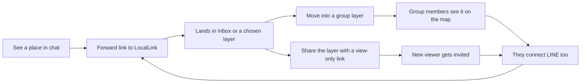
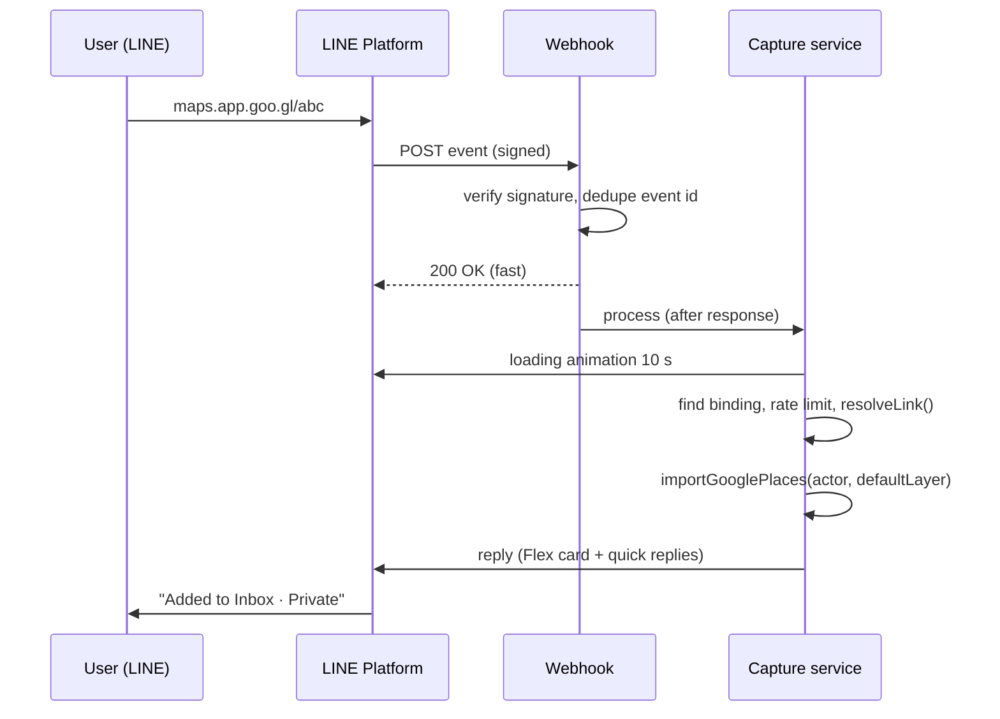

# Send places from chat: DM a link to add it to a layer

Status: design proposal, 2026-11-01. Prototype: [docs/design/dm-link-to-layer/prototype.html](../design/dm-link-to-layer/prototype.html).

Implementation note (2026-11-01): a first slice is built behind `FEATURE_CHAT_CAPTURE`. It covers LINE and Instagram webhooks, linking by one-time code with web confirmation for **both** channels (LINE's native account-link flow is deferred), the Inbox default plus a destination-layer setting, plain-text replies, and **Recently sent**. Flex cards, quick-reply moves, Undo, the held link for unlinked senders, and the "via LINE" badge are not built. Operator setup: [docs/guides/chat-capture-setup.md](../guides/chat-capture-setup.md). No real LINE or Instagram accounts exist yet.

Working name: **Send to LocalLink** / **傳給 LocalLink**. Copy uses `{brand}` so the rebrand helper (`packages/shared/src/brand.ts`) supplies the name.

## 1. Problem, users and loop

People find places inside chat apps, not on our site. A friend drops a `maps.app.goo.gl` link in a LINE group, or a food account posts a reel. Today, getting that into a layer means opening LocalLink, finding the layer, opening the editor and pasting into **Google Maps or Instagram links**. That takes about six steps, and most saves never happen.

The feature: forward or paste the link into a 1:1 chat with LocalLink's official LINE account (later Instagram), and the place lands in one of your layers. The chat reply confirms the place, says which layer it went to and who can see it, and lets you move or undo it.

**Target users**

- Taiwanese and Taiwanese-American members in Taipei, Houston and Tokyo who already live in LINE. LINE is the default messenger in Taiwan and Japan, the two non-US launch cities.
- Group editors who collect places for an outing (for example, "Saturday club outing").
- Instagram-first food followers (phase 2). Their links rarely carry a resolvable place, so the design treats them as a separate, harder case.

**The loop it joins**



This is a **capture** surface for the existing loop (paste links → layer → group → share), not a new loop. It lowers the cost of the first step, which the [scope review](product-scope-review-2026-10.md) found was the gate ("the first run is paste links"). Its health shows up in funnel stage 5 of [activation-funnel.md](../reference/activation-funnel.md): a second distinct contributor on a group layer within 7 days.

## 2. Principles

1. **Reuse the resolver, never re-implement it.** Google links go through `resolveLink()` in `apps/web/src/features/google-links/resolver.ts` and are added by the same transactional, authorized import as the web (`importGooglePlaces`). The chat is just another input box.
2. **Private by default.** With no other choice made, a sent place lands in the sender's private **Inbox** layer. A place only reaches a group layer if the user picks one, and the reply then says plainly who can see it.
3. **Chat never decides authorization.** The webhook only identifies the sender. The server derives the actor from the stored channel link and rechecks edit rights on every write, move and undo.
4. **No invented facts.** The chat card shows only the name read from the user's own link (`link_name`), or no name. It never shows a place name, address or coordinates from a model, and coordinates come only from the provider or geocoder. Instagram candidates always need an explicit tap.
5. **Message text is hostile data.** Only URLs are extracted, with the existing strict parsers. Raw message text is not stored, logged or sent to a model.
6. **Platform IDs are personal data.** A LINE user ID or Instagram-scoped ID is stored encrypted, looked up by keyed hash, never sent to analytics, and deleted when the user disconnects.
7. **One config-driven channel model.** LINE and Instagram are two rows in one `messaging channel` abstraction. Adding a channel later (for example WhatsApp or Telegram) means a new adapter, not new screens.

## 3. What exists today versus what is proposed

| Capability                                             | Today                                                                                                                                                                                                  | Proposed                                                                     |
| ------------------------------------------------------ | ------------------------------------------------------------------------------------------------------------------------------------------------------------------------------------------------------ | ---------------------------------------------------------------------------- |
| Google Maps link → place ID                            | Built: `resolveLink()`, allowlisted short-link expansion, IDs-only Text Search, budget of 150 links per member per 10 minutes                                                                          | Reused unchanged                                                             |
| Add places to an editable layer                        | Built: `importGooglePlaces()` / `createLayerFromGoogle()` in `features/google-links/service.ts`, `requireEditableLayer`, dedupe per layer, `link_name`, `sourceLinks`                                  | Reused; new caller records `source`                                          |
| Editable-layer list                                    | Built: `listEditableLayers(actor)` (own layers plus group layers where role is owner/editor, not archived)                                                                                             | Reused for the chat layer picker, with public-audience layers filtered out   |
| Instagram post → candidates                            | Partial: an operator-hosted worker (Playwright + local Ollama) behind `INSTAGRAM_WORKER_URL`; five posts per member per 10 minutes; caption only; 190 s timeout. The scope review suggested cutting it | Phase 2 only, and only if the owner keeps Instagram in scope (open question) |
| Layer item attribution                                 | `layer_item.added_by` exists                                                                                                                                                                           | Add `layer_item.added_via`                                                   |
| View-only share links, group-owner invites, Daily Pick | Built locally (`/shared/[token]`, `layer_share_link`), prod needs migration 0031                                                                                                                       | Linked from the chat card (section 9)                                        |
| LINE / Instagram accounts, webhooks, account links     | None                                                                                                                                                                                                   | All new                                                                      |

## 4. Platform constraints (checked 2026-11-01)

Verify these again in phase 0 against the live consoles. Where sources disagree, the table says so.

| Topic                       | Finding                                                                                                                                                                                                                                                                                                                                             | Design consequence                                                                                                                         |
| --------------------------- | --------------------------------------------------------------------------------------------------------------------------------------------------------------------------------------------------------------------------------------------------------------------------------------------------------------------------------------------------- | ------------------------------------------------------------------------------------------------------------------------------------------ |
| LINE reply token            | Single use. LINE does not publish a fixed lifetime; its engineering guide says it is counted in seconds and varies with load. The API reference lists "Invalid reply token" for an expired or used token. Third-party reports range from about 30 s to 60 s.                                                                                        | Reply within a few seconds. Do the slow work after acknowledging the webhook, and fall back to push only if the reply fails.               |
| LINE reply vs push cost     | Reply messages do not count toward the plan's free monthly messages. Push, multicast, broadcast and narrowcast do, counted per recipient.                                                                                                                                                                                                           | The happy path uses replies only. Push is a capped fallback with a monthly budget.                                                         |
| LINE plan quotas            | Free messages vary by country and plan. LINE's docs show a Japan example (free plan: 200). Unofficial Taiwan sources list 200 / 3,000 / 6,000 messages for the light / mid / high plans (NT$0 / 800 / 1,200), with no extra purchases on the first two. Unconfirmed officially.                                                                     | Pick the account's country and plan in phase 0. Set the push budget well below the free quota.                                             |
| LINE quick reply            | Up to 13 buttons on any message type. Actions include postback, message, URI, datetime picker, camera, camera roll and location. iOS and Android only.                                                                                                                                                                                              | Layer picker = up to 10 recent layers + Inbox + "More layers…" (URI) + Undo. Desktop LINE users get the Flex buttons and the URI fallback. |
| LINE Flex Message           | Bubble/carousel layouts (carousel up to 12 bubbles). `altText` is required and appears in notifications and chat lists. Byte limits are cited only by third parties (30 KB bubble).                                                                                                                                                                 | One `kilo`/`mega` bubble per reply. Always write a meaningful `altText`.                                                                   |
| LINE loading animation      | `POST /v2/bot/chat/loading/start`, 5–60 s in steps of 5, 1:1 chats only, cleared by the next message.                                                                                                                                                                                                                                               | Start it as soon as a link arrives.                                                                                                        |
| LINE webhook signature      | HMAC-SHA256 of the raw body with the channel secret, base64, compared with `x-line-signature`. Must use the raw body.                                                                                                                                                                                                                               | Verify before parsing. Use a constant-time compare.                                                                                        |
| LINE account linking        | Messaging API account link: the bot gets a 10-minute, single-use `linkToken` from `POST /v2/bot/user/{userId}/linkToken`. Our site makes a nonce and redirects to `access.line.me/dialog/bot/accountLink`. An `accountLink` webhook event returns the nonce. LINE checks that the person linking owns the account. No LINE Login channel is needed. | Use this for LINE and skip one-time codes.                                                                                                 |
| LINE user IDs               | IDs are per provider. A Messaging API channel and a LINE Login channel under the same provider share IDs.                                                                                                                                                                                                                                           | If LINE Login is ever added as a sign-in method, create it under the same provider.                                                        |
| LINE URL schemes            | `line.me/R/ti/p/{id}` (add friend / open chat), `line.me/R/oaMessage/{id}/?{text}` (prefilled message), `line.me/R/share?text=` (share picker). Not supported in every context; PC may show only a QR code.                                                                                                                                         | Web "Connect LINE" shows a QR on desktop and an Open LINE button on phones.                                                                |
| Instagram messaging access  | Needs an Instagram professional (business/creator) account. Scopes: `instagram_business_basic` + `instagram_business_manage_messages` (Instagram Login). Standard Access only reaches people with a role on the app. Advanced Access needs App Review and Business Verification.                                                                    | Instagram is a later phase. Plan for Meta review and business verification lead time.                                                      |
| Instagram 24 h window       | A business may message a user only after the user writes first, and only within 24 h. The Human Agent tag (7 days) is for real people, not automation.                                                                                                                                                                                              | Reply right away. Never send follow-ups after 24 h. Everything else waits for the web.                                                     |
| Instagram shared posts      | A shared post or reel arrives as an attachment whose payload carries only the URL (`ig_reel` carries title, link and video ID). Meta is moving post shares from `share` to `ig_post`; the changelog has conflicting dates. No location tag is delivered.                                                                                            | Location tags are unavailable through the official API. Accept `share`, `ig_post` and `ig_reel`; treat the title as untrusted text.        |
| Instagram quick replies     | Third parties say 13 per message, 20 characters each, app only (not web); generic templates have up to 10 cards and up to 3 buttons each. Not confirmed in Meta's docs.                                                                                                                                                                             | Keep each label under 20 characters. Always offer a web link as the fallback.                                                              |
| Instagram webhook signature | `X-Hub-Signature-256: sha256=<HMAC-SHA256(raw body, app secret)>`. GET handshake with `hub.verify_token` / `hub.challenge`.                                                                                                                                                                                                                         | Same pattern as LINE.                                                                                                                      |
| Meta oEmbed                 | "Meta oEmbed Read" replaced oEmbed Read (old one retired 2025-11-03). Needs App Review. Author and thumbnail fields were removed. No documented caption or location.                                                                                                                                                                                | Do not plan on oEmbed for place facts.                                                                                                     |

## 5. Decisions

### D1. Account linking

**LINE: use the Messaging API account-link flow.** It proves LINE account ownership, needs no LINE Login channel and needs no code typed by hand.

- **Entry from chat (main path).** Someone adds the account as a friend or sends a first message. The bot replies with a **Connect your account** button. Behind it, the server requests a `linkToken`, and the button points to `https://{site}/connect/line?linkToken=…`.
- **Entry from the web.** **Profile → Send places from chat → Connect LINE** shows the add-friend QR (desktop) or an **Open LINE** button (`line.me/R/ti/p/@…`, phone). After that the chat entry takes over, so the two paths end in one flow.
- On `/connect/line` the user signs in if needed. The page then says **Connect LINE to {name}'s account?** and has Connect and Cancel buttons. Connect creates a random nonce (at least 128 bits, single use, 10 minutes) bound to the session user and redirects to LINE's account-link dialog. The `accountLink` webhook event (`result: ok`) carries the nonce. The server binds the LINE user ID to the nonce's user, deletes the nonce and replies "Connected".
- **LINE Login (sign in with LINE)** is not in this feature. Membership is invite-only and Better Auth currently offers email OTP and Google. LINE Login would add a second identity surface for no capture benefit. Revisit it as a growth option. If it is ever added, it must sit under the same LINE provider so the IDs match.

**Instagram: a one-time code with web confirmation**, because Instagram has no account-link API.

1. On the web, **Connect Instagram** creates a code like `LL-7K4Q-9M` (8 characters from a no-ambiguity alphabet, 10 minutes, single use, stored hashed). The page shows the code, a **Copy and open Instagram** button (`ig.me/m/{handle}`, to be verified in phase 0) and a waiting state.
2. The user sends the code to the LocalLink account in a DM.
3. The webhook matches the code and records a **pending** binding.
4. The waiting page (polling) shows **An Instagram account wants to connect. Is this you?** with the handle if the profile API returns one. The user confirms on the web.

The web confirmation stops someone who sees the code from attaching their own Instagram to your account and writing into your layers.

**Unlinked senders**

- A link sent before connecting gets one reply: what the bot does, the Connect button, and **I'll add this place once you connect (within 15 minutes)**. Only the canonical URL of the last link is kept, keyed by the hashed sender ID. It is resolved after the link completes and discarded after 15 minutes either way. Raw text is never kept.
- If the person signs in but is not a LocalLink member, `/connect/line` shows the existing invite-only membership message and the request-access path. The held link is discarded. The bot says nothing more, because there is no reply token left for that sender and pushes cost quota.
- At most one onboarding reply per sender per 10 minutes. Later messages get no reply until the user connects. This stops loops and spam.

**Disconnecting**

- **Disconnect** on the web deletes the binding and any pending items.
- A LINE `unfollow` event (the user blocks the account) also deletes the binding. Following again means connecting again, which is one tap if the web session is live.
- Deleting the LocalLink account cascades to bindings and receipts.

### D2. Target layer

Recommendation: **default to a private Inbox, offer a quick-reply layer picker on every confirmation, and never use "last used" as a silent default.**

| Option                  | Pros                                               | Cons                                                                                                                                        | Verdict                                                     |
| ----------------------- | -------------------------------------------------- | ------------------------------------------------------------------------------------------------------------------------------------------- | ----------------------------------------------------------- |
| Default "Inbox" layer   | Zero friction; always valid; mistakes stay private | Places have to be sorted later                                                                                                              | **Default**                                                 |
| Ask every time (picker) | Exact placement                                    | Adds a step to every send; quick replies are app-only; the reply token is used by the question, so the result needs a second (push) message | Available as **Move to…** after adding, not as a gate       |
| Last-used layer         | Fast for batch sessions                            | Silently posts into a group layer hours or days later; mistakes are visible to others                                                       | Rejected as a silent default; used only to order the picker |

**Settings (Profile → Send places from chat)**

- **Where sent places go**: Inbox (default) or one chosen layer. The list is `listEditableLayers` minus public-audience layers and archived ones.
- If the chosen layer is a group layer, the setting shows **Members of {group} will see places you send** and every confirmation repeats the audience.
- If the user loses edit rights to the chosen layer, or it is archived, the server falls back to Inbox. The reply says **{layer} isn't available, so this went to your Inbox**, and the setting shows a warning.

**The Inbox**

The Inbox is an ordinary private user layer, made on first use. The server keeps its ID in `messaging_link.inbox_layer_id`. It is not a system layer, so it appears on the map, in the list fallback and in the layer workspace, and it obeys map/list agreement with no new query rules. The user can rename it. They cannot change its audience to group; to share those places they use **Move to…**. That keeps the "private by default" promise without a new visibility rule.

**Picker contents**

- Up to 10 editable layers, ordered by the user's most recent DM moves, then `updated_at`.
- Plus **Inbox**, **More layers…** (a URI to a web picker that lists them all) and **Undo**. That is 13 at most, LINE's limit.
- Labels are truncated to 20 characters (the Instagram limit; also readable on LINE). Group layers are prefixed in the label text, for example `Group: Saturday outing` / `群組：週六聚會`, because quick replies have no other way to show the audience.

Every write rechecks `requireEditableLayer` on the server. A postback carries only an opaque receipt ID and an action, never a layer ID the client could swap: the move target is an index into a server-side snapshot of the picker, stored on the receipt.

### D3. Link types

| Input                                                                                     | Handling                                                                                                                                                                                                                                                                                        |
| ----------------------------------------------------------------------------------------- | ----------------------------------------------------------------------------------------------------------------------------------------------------------------------------------------------------------------------------------------------------------------------------------------------- |
| `google.com/maps/place/…`, `maps.google.com/?q=…`, links with `place_id`/`query_place_id` | `resolveLink()` as is. The name in the link becomes `link_name`.                                                                                                                                                                                                                                |
| `maps.app.goo.gl/…`, `goo.gl/maps/…`                                                      | Same resolver: allowlisted, hop-by-hop expansion, body never read.                                                                                                                                                                                                                              |
| Google Maps saved lists                                                                   | `unsupported` (`list`), as on the web (decision M1). The reply points to **Import a shared map** on the web for My Maps.                                                                                                                                                                        |
| CID-only links with no name                                                               | `unsupported` (`no_place_name`). Reply: **This link doesn't include the place name. Send the place's share link instead, or reply with the name.** The bot then waits for a name (see the fallback below).                                                                                      |
| Instagram post/reel URL, or a shared post/reel attachment                                 | Phase 2. See [Instagram](#instagram-links).                                                                                                                                                                                                                                                     |
| Any other URL                                                                             | **I can add places from Google Maps links{igSuffix}. This link isn't one.** No fetch, no preview, and the URL is not echoed back.                                                                                                                                                               |
| Text with no URL                                                                          | Help reply, unless the bot is waiting for a name (fallback). Commands `help`/`說明`, `inbox`/`收件匣` (opens the web receipts) and `disconnect`/`解除連結` (asks for confirmation) are exact matches only.                                                                                      |
| Stickers, images, video, voice, files                                                     | Help reply. Images are not read; OCR would turn guesses into facts.                                                                                                                                                                                                                             |
| LINE location message                                                                     | Only while the bot is waiting for a name: used as the search **bias** for that name and not stored. Otherwise: **To add a place, send its Google Maps link.**                                                                                                                                   |
| Several links in one message                                                              | Up to **5** are processed in order. The rest get **I added the first 5. Send the others in another message.** Duplicates within the message collapse. All go to the same destination, and one summary card covers all of them with **Undo all**. Per-item undo and move are on the web receipt. |

URL extraction uses the shared `extractUrl` helpers and is bounded: at most 20 candidates scanned, each at most 2,048 characters, and only messages up to 5,000 characters are considered.

**The "couldn't find it, pick one" fallback (both channels)**

1. When a link resolves to `not_found` or `no_place_name`, or an Instagram post gives no usable place, the bot replies with the reason and three options: **Reply with the place name**, **Pick on the web** (URI to the editor's add-place flow, prefilled with the source link as the note) and **Skip**.
2. A name reply (within 10 minutes) runs one IDs-only Text Search, biased to the user's current city (or to the LINE location if one was sent). Name length is capped at 120 characters.
3. The result card says **Best match for "{query}"**. It has an **Open in Google Maps** button (a `place_id` URL so the user checks it on Google, not on our card), **Add** and **Not it**. Nothing is added before **Add**.
4. **Not it**, or no match, leads to the web pick: **Pick on the web**, where the existing custom-place flow (geocoder or drop a pin, marked approximate) applies.

<a id="instagram-links"></a>

**Instagram links (phase 2)**

What we can know, honestly:

- **Location tags:** not in the webhook payload and not readable for other people's posts through the official API. **Not used.**
- **Caption:** only through the existing operator worker, which loads the public post signed out and runs a local model. It takes up to 190 s, so the reply token or the first reply is used for **Looking at this post. I'll message you when it's done** and the result comes as a push (LINE, counted against the quota) or a second message inside the 24 h window (Instagram).
- **Reel title** (`ig_reel` payload): untrusted text, at most 200 characters. It is used only as a candidate search string, the same as a caption.

Flow:

1. Candidates come from the worker (name plus optional address). Each one is run through IDs-only Text Search, at most 3 per post (the web allows 5).
2. The reply lists the candidates as **Is it one of these?** with an **Open in Google Maps** button each. Nothing is added until the user taps **Add**. There is never automatic addition from a model.
3. No candidates, worker unavailable or busy, or extraction failed: go to the "pick one" fallback above.
4. The per-member limit is shared with the web (5 posts per 10 minutes).

If the owner keeps Instagram out of scope (as the scope review suggested), drop the worker path. Instagram links then go straight to the "pick one" fallback, which still works without a model.

### D4. Confirmation and undo

**LINE Flex bubble (one per reply)**

```
┌──────────────────────────────────┐
│ ✓ Added to Inbox                 │  header: layer title
│   Private · only you             │  audience line (group: "Group · 8 members")
├──────────────────────────────────┤
│ Din Tai Fung 鼎泰豐               │  link_name, or "Google place (name shows in LocalLink)"
│ From your Google Maps link       │  provenance, never "verified"
├──────────────────────────────────┤
│ [ Open in LocalLink ]  [ Undo ]  │  URI button | postback
└──────────────────────────────────┘
Quick replies: Inbox · Group: Saturday outing · Tokyo trip · … · More layers… · Undo
```

- `altText`: **Added "Din Tai Fung" to Inbox (private)** / **已將「鼎泰豐」加入 收件匣（私人）**.
- **Already there:** **Din Tai Fung is already in Inbox.** It has no Undo, because the action created nothing, and it keeps the move quick replies.
- **Several links:** one bubble listing up to 5 rows with a status glyph and text (**Added**, **Already there**, **Not found**, **Not a place link**), plus **Undo all** and **Open in LocalLink**.
- **Move** (quick reply or postback) moves the receipt's items from the source layer to the target in one transaction. It rechecks edit rights on both layers and uses the layer revision checks. Items that already existed in the source before this receipt are not removed. The reply is **Moved to Saturday outing · Group · 8 members** with Undo.
- **Undo** removes only `layer_item` rows created by this receipt (tracked by ID), only within **24 hours**, and only while the user can still edit that layer. After that: **Too late to undo here. Remove it in LocalLink.** with an Open button. Undo is idempotent; a second tap gets **Already undone**.
- **Instagram** uses a generic template card (title, subtitle, up to 3 buttons: Open, Undo, Move…) plus quick replies for layers. Since quick replies do not show on Instagram web, **Move…** opens the web picker.

**Web**

- **"via LINE" / "via Instagram" badge** on the item row in the layer workspace editor and in the selected place's detail panel. It is shown only to the layer's editors, as attribution metadata next to the existing "added by". Viewers and share-link visitors do not see it, so it does not reveal which messenger a member uses.
- **Inbox layer** shows on the map and in the list like any private layer. Its library card has a count and a **Sort places** hint while it is not empty.
- **Recently sent** (Profile → Send places from chat → Recently sent). This is the review surface: a 30-day list of receipts, newest first. Each row shows the time, channel, place (link name), destination layer and status. Actions: **Move**, **Remove** and, for unresolved rows, **Find place**. It is the only place unresolved sends ("Not found", "Couldn't read post") survive, so nothing is lost even if the user ignores the chat.
- No hidden or pending visibility state is added to layer items. The default lands in a private layer, which already gives "review before others see it" without changing map queries.

### D5. Trust and safety

| Risk                                  | Control                                                                                                                                                                                                                                                                                                                                                                                                                                                      |
| ------------------------------------- | ------------------------------------------------------------------------------------------------------------------------------------------------------------------------------------------------------------------------------------------------------------------------------------------------------------------------------------------------------------------------------------------------------------------------------------------------------------ |
| Forged webhooks                       | Verify `x-line-signature` / `X-Hub-Signature-256` over the raw body with a constant-time compare **before** parsing. Reject bodies over 1 MB. Separate secrets per environment. Unknown `destination` / page IDs are dropped.                                                                                                                                                                                                                                |
| Replays and redelivery                | Idempotency on the platform event ID (LINE `webhookEventId`, Instagram `mid`) with a unique constraint on the receipt. A redelivered event gets no second write and no second reply.                                                                                                                                                                                                                                                                         |
| Abuse, cost runaway                   | Per sender: 20 links per 10 minutes, on top of the existing member budget (150 links per 10 minutes) and the 5-post Instagram limit, sharing the same `rate_limit` rows so web and chat cannot be combined to exceed them. Unlinked senders: one reply per 10 minutes. Global: a daily Text Search cap and a monthly LINE push budget; when either is reached, chat replies say **Busy. Your link is saved in LocalLink.** and the receipt waits on the web. |
| Group chats                           | The bot works only in 1:1 chats. When added to a LINE group or multi-person chat, it replies once ("I only work in a 1:1 chat") and leaves. Messages from groups are never processed or stored.                                                                                                                                                                                                                                                              |
| Public exposure                       | DM writes never target a public-audience layer: the picker and the server both exclude them. Unreviewed Google subjects already stay out of public views (`city_review_status`). Group layers are reachable only by explicit choice with the audience stated.                                                                                                                                                                                                |
| Fabricated place facts                | The card shows only `link_name` (the user's own link text) or the user's own search text, labeled as such. No model output is shown as fact. Coordinates come from the existing Place Details location cache or the geocoder, never from URLs, messages, LINE location payloads or models. Instagram candidates need a tap.                                                                                                                                  |
| Hostile message text                  | URL extraction only, with the existing parsers. Text is never interpolated into prompts. Reply copy is template-based, and the only user-derived strings echoed are `link_name` or a search query, normalized, control characters stripped and truncated to 80 characters. The Instagram worker receives only the canonical post URL, as today.                                                                                                              |
| SSRF                                  | No new fetch path. Short links go through the resolver's allowlist. Instagram goes through the existing worker. Other URLs are never fetched.                                                                                                                                                                                                                                                                                                                |
| Platform ID privacy                   | Store `external_id_hash = HMAC-SHA256(key, channel:id)` for lookup and `external_id_enc` (AES-GCM with a new crypto purpose) only so we can call the platform's push and profile APIs. Never put IDs in analytics, logs, URLs, error messages or LLM requests. Delete on disconnect, unfollow and account deletion.                                                                                                                                          |
| Account takeover by link interception | LINE: the platform verifies ownership in the account-link dialog. Instagram: web confirmation of the pending binding. Both: codes and nonces are single use and expire in 10 minutes.                                                                                                                                                                                                                                                                        |
| Message retention                     | Receipts keep the canonical source URL (tracking parameters stripped), result statuses, layer and item IDs, and timestamps. They are deleted after 30 days. Raw message text is never stored. The held link for unlinked senders lasts 15 minutes.                                                                                                                                                                                                           |
| Platform outage or misconfiguration   | Missing env vars mean the webhook returns 503 and the settings page shows **Not available yet**. The web paste flow is unaffected.                                                                                                                                                                                                                                                                                                                           |

## 6. User flows

### F1. Connected LINE user sends a Google Maps link (happy path)



1. The user pastes or forwards the link.
2. Within about 2 s the loading animation shows. Within about 5 s the card arrives.
3. Optional: tap a quick reply to move it, or Undo.
4. On the web, the place is in the layer with the "via LINE" badge and appears in **Recently sent**.

If the reply token fails (expired, or processing was slow), the result is pushed if the monthly push budget allows. Otherwise it is recorded on the receipt only, and the next interaction says **Your last link was added to Inbox**.

### F2. Unlinked sender

1. A stranger sends a link, or follows the account. Reply: welcome text, **Connect your account**, and **I'll add this place once you connect** (only if a link was sent).
2. They tap Connect. `/connect/line?linkToken=…` opens.
   - Signed out: sign in (email OTP / Google), then return.
   - Not a member: invite-only message and request access. Stop.
   - Member: **Connect LINE to this account?** Connect.
3. LINE's account-link dialog. `accountLink` event. The binding is saved.
4. The bot replies **Connected. Send me any Google Maps link.** If a held link exists, it is processed and that card is the reply.
5. The web page shows **LINE connected** and a **Where sent places go** setting.
6. Errors: an expired link token gives **This link expired. Send any message to LocalLink on LINE to get a new one.** A `result: failed` event gives **Couldn't connect. Try again from the chat.** If the LINE account is already linked to another LocalLink account, the reply is **This LINE account is connected to another LocalLink account. Disconnect it there first.**, which reveals no other details.

### F3. Change layer and undo

1. The confirmation shows quick replies.
2. Tap **Group: Saturday outing**. Postback `{r: receiptId, a: "move", i: 2}`.
3. The server rechecks the binding, the receipt owner, edit rights on both layers and the 24 h window, then moves the items in one transaction.
4. Reply: **Moved to Saturday outing · Group · 8 members can see it** with Undo, which moves the items back to the original layer.
5. **Undo** on any card removes this receipt's created items. Reply: **Removed from Saturday outing.**

### F4. Instagram fallback (phase 2)

1. The user shares a reel to LocalLink's Instagram account, or pastes an Instagram link in LINE.
2. Reply: **Looking at this post…**
3. Either candidates appear (**Is it one of these?**, each with Open in Google Maps and Add) or **Couldn't find the place in this post.** with **Reply with the name** / **Pick on the web** / **Skip**.
4. The user replies with the name. A best-match card appears. Add.
5. Same card as F1, with provenance **From a post you shared** in place of **From your Google Maps link**.

### F5. Web connect screen (signed in)

1. Profile → **Send places from chat**.
2. LINE row: **Not connected** + **Connect LINE** (QR on desktop, Open LINE on phone). Instagram row: **Coming soon**, or **Connect Instagram** once the phase ships.
3. Once connected: the account row shows **Connected** with the connection date (no ID, no display name), the **Where sent places go** select and **Disconnect**.
4. **Recently sent** list below.

### States

| State                                           | Web                                                                                                                                       | Chat                                                                                                         |
| ----------------------------------------------- | ----------------------------------------------------------------------------------------------------------------------------------------- | ------------------------------------------------------------------------------------------------------------ |
| Signed out                                      | `/profile` redirects to sign-in as today. `/connect/line` keeps `linkToken` through sign-in.                                              | Unlinked flow (F2)                                                                                           |
| Feature flag off or channel not configured      | The settings row says **Not available yet**. No Connect button.                                                                           | The webhook returns 503. LINE shows nothing. The OA auto-reply in LINE Official Account Manager can explain. |
| Empty (connected, nothing sent)                 | **Recently sent** empty state: **Places you send in chat appear here.** + **How to send** (3 steps)                                       | n/a                                                                                                          |
| No editable layers besides Inbox                | The select lists only Inbox, with a **Create a layer** link                                                                               | The picker shows Inbox + More layers…                                                                        |
| Default layer lost (rights removed or archived) | Warning on the setting, falls back to Inbox                                                                                               | **{layer} isn't available, so this went to your Inbox.**                                                     |
| No map token / map failure                      | The Inbox and receipts work in the list fallback. **Open in LocalLink** links to `/?layers=<inbox>&view=list` when the client has no map. | Card unchanged                                                                                               |
| Place has no cached coordinates yet             | List-only until the location cache fills it, as today                                                                                     | Card unchanged; never says "on the map" until it is                                                          |
| Rate limited                                    | Receipts show **Skipped: too many links**                                                                                                 | **You've sent a lot of links. Try again in a few minutes.**                                                  |
| Provider error                                  | Receipt **Couldn't check this link** + Retry                                                                                              | **Couldn't check this link right now. It's saved in Recently sent; try again there.**                        |

## 7. Bot copy (English / Traditional Chinese)

Server-side copy lives in a new `apps/web/src/lib/messaging-copy.ts` (same pattern as `map-import-copy.ts`), keyed and typed so both languages have every key. **Language choice:** the LocalLink account locale once linked. Before linking, the LINE profile `language` if the platform returns it (to be verified), otherwise Traditional Chinese for LINE and English for Instagram. Mixed-language strings are never used.

| Key                  | English                                                                                        | 繁體中文                                                            |
| -------------------- | ---------------------------------------------------------------------------------------------- | ------------------------------------------------------------------- |
| `welcome`            | Send me a Google Maps link and I'll add the place to your {brand} layer.                       | 傳 Google 地圖連結給我，我會把地點加進你的 {brand} 圖層。           |
| `connectPrompt`      | First, connect your {brand} account.                                                           | 請先連結你的 {brand} 帳號。                                         |
| `connectButton`      | Connect account                                                                                | 連結帳號                                                            |
| `heldLink`           | I'll add this place once you connect (within 15 minutes).                                      | 連結帳號後（15 分鐘內），我會幫你加入這個地點。                     |
| `connected`          | Connected. Send me any Google Maps link.                                                       | 已連結！之後傳 Google 地圖連結給我就可以了。                        |
| `connectExpired`     | This link expired. Send any message here to get a new one.                                     | 連結已過期，請在這裡傳任一訊息取得新的連結。                        |
| `connectFailed`      | Couldn't connect. Try again from this chat.                                                    | 連結失敗，請在這個聊天室再試一次。                                  |
| `connectedElsewhere` | This LINE account is connected to another {brand} account. Disconnect it there first.          | 這個 LINE 帳號已連結到其他 {brand} 帳號，請先在該帳號解除連結。     |
| `addedTo`            | Added to {layer}                                                                               | 已加入「{layer}」                                                   |
| `audiencePrivate`    | Private · only you                                                                             | 私人・只有你看得到                                                  |
| `audienceGroup`      | Group · {count} members can see it                                                             | 群組・{count} 位成員看得到                                          |
| `fromLink`           | From your Google Maps link                                                                     | 來自你的 Google 地圖連結                                            |
| `fromPost`           | From a post you shared                                                                         | 來自你分享的貼文                                                    |
| `unnamedPlace`       | Google place (name shows in {brand})                                                           | Google 地點（名稱請在 {brand} 查看）                                |
| `alreadyThere`       | {place} is already in {layer}.                                                                 | 「{place}」已經在「{layer}」裡了。                                  |
| `openInApp`          | Open in {brand}                                                                                | 在 {brand} 開啟                                                     |
| `undo`               | Undo                                                                                           | 復原                                                                |
| `undoAll`            | Undo all                                                                                       | 全部復原                                                            |
| `undone`             | Removed from {layer}.                                                                          | 已從「{layer}」移除。                                               |
| `alreadyUndone`      | Already undone.                                                                                | 已經復原了。                                                        |
| `undoExpired`        | Too late to undo here. Remove it in {brand}.                                                   | 已超過可復原時間，請到 {brand} 移除。                               |
| `moveMore`           | More layers…                                                                                   | 更多圖層…                                                           |
| `movedTo`            | Moved to {layer}                                                                               | 已移到「{layer}」                                                   |
| `defaultUnavailable` | {layer} isn't available, so this went to your Inbox.                                           | 無法使用「{layer}」，已改加入你的收件匣。                           |
| `inboxName`          | Inbox                                                                                          | 收件匣                                                              |
| `batchSummary`       | {added} added · {skipped} not added                                                            | 已加入 {added} 個・{skipped} 個未加入                               |
| `batchLimit`         | I added the first 5. Send the others in another message.                                       | 一次最多處理 5 個連結，其餘請另外傳送。                             |
| `rowAdded`           | Added                                                                                          | 已加入                                                              |
| `rowAlready`         | Already there                                                                                  | 已存在                                                              |
| `rowNotFound`        | Not found                                                                                      | 找不到                                                              |
| `rowUnsupported`     | Not a place link                                                                               | 不是地點連結                                                        |
| `notPlaceLink`       | I can add places from Google Maps links. This link isn't one.                                  | 我只能加入 Google 地圖地點連結，這個連結不是。                      |
| `listLink`           | That's a saved list. To bring a whole map, use "Import a shared map" in {brand}.               | 這是收藏清單。若要匯入整張地圖，請在 {brand} 使用「匯入共享地圖」。 |
| `noPlaceName`        | This link doesn't include the place name. Send the place's share link, or reply with the name. | 這個連結沒有地點名稱。請改傳地點的分享連結，或直接回覆店名。        |
| `notFound`           | Couldn't find this place on Google Maps.                                                       | 在 Google 地圖上找不到這個地點。                                    |
| `replyWithName`      | Reply with the name                                                                            | 回覆店名                                                            |
| `pickOnWeb`          | Pick on the web                                                                                | 到網站選擇                                                          |
| `skip`               | Skip                                                                                           | 略過                                                                |
| `askName`            | What's the place called? (Reply within 10 minutes.)                                            | 這個地點叫什麼名字？（請在 10 分鐘內回覆）                          |
| `bestMatch`          | Best match for "{query}"                                                                       | 「{query}」最相符的結果                                             |
| `checkOnGoogle`      | Open in Google Maps                                                                            | 在 Google 地圖查看                                                  |
| `add`                | Add                                                                                            | 加入                                                                |
| `notIt`              | Not it                                                                                         | 不是這個                                                            |
| `igWorking`          | Looking at this post. I'll message you when it's done.                                         | 正在查看這則貼文，完成後會通知你。                                  |
| `igCandidates`       | Is it one of these?                                                                            | 是下面其中一個嗎？                                                  |
| `igNoPlace`          | Couldn't find the place in this post.                                                          | 在這則貼文中找不到地點。                                            |
| `igUnavailable`      | Instagram posts can't be read right now.                                                       | 目前無法讀取 Instagram 貼文。                                       |
| `rateLimited`        | You've sent a lot of links. Try again in a few minutes.                                        | 你傳了很多連結，請幾分鐘後再試。                                    |
| `providerError`      | Couldn't check this link right now. It's saved in Recently sent; try again there.              | 目前無法檢查這個連結，已保留在「最近傳送」，請到網站重試。          |
| `busy`               | Busy right now. Your link is saved in {brand}.                                                 | 目前忙碌中，連結已保留在 {brand}。                                  |
| `help`               | Send a Google Maps place link to add it. Commands: help · inbox · disconnect                   | 傳 Google 地圖地點連結即可加入。指令：說明・收件匣・解除連結        |
| `groupChatLeave`     | I only work in a 1:1 chat. Message me directly.                                                | 我只能在一對一聊天中使用，請直接傳訊息給我。                        |
| `disconnectConfirm`  | Disconnect this chat from {brand}? Places already added stay.                                  | 要解除這個聊天與 {brand} 的連結嗎？已加入的地點會保留。             |
| `disconnected`       | Disconnected.                                                                                  | 已解除連結。                                                        |
| `lastWasAdded`       | Your last link was added to {layer}.                                                           | 你上一個連結已加入「{layer}」。                                     |

The Chinese copy needs a native review before launch. Follow the existing glossary: 圖層 = layer, 收件匣 = Inbox.

## 8. Web UI spec

### Routes and components

| Surface                         | Route / component                                                                                                 | Reuses                                                                                                         |
| ------------------------------- | ----------------------------------------------------------------------------------------------------------------- | -------------------------------------------------------------------------------------------------------------- |
| Settings entry                  | New row in `/profile` `settings-rows` nav: **Send places from chat →**                                            | Existing `settings-rows` pattern                                                                               |
| Connections page                | `/profile/connections` (new)                                                                                      | `form-panel`, `Field`/`fieldProps` (`components/ui/field.tsx`), `StatusMessage` (`components/actions`)         |
| Connect LINE landing            | `/connect/line` (new)                                                                                             | Sign-in redirect, membership notice                                                                            |
| Connect Instagram               | `/profile/connections/instagram` (phase 2)                                                                        | Same panel; polling status                                                                                     |
| Recently sent                   | Section of `/profile/connections`                                                                                 | Row styling from `google-link-result status-*` in `google-links-form.tsx`; move picker from `add-to-layer.tsx` |
| "via LINE" badge                | Layer workspace item row (`layer-editor.tsx` contents list) and `layer-google-places.tsx` rows; detail panel meta | Existing meta chip styles (`ItemMeta`)                                                                         |
| Web layer picker (More layers…) | `/profile/connections/move?r=<receipt>` (signed in, receipt owner only)                                           | `AddToLayer` list semantics                                                                                    |

### Layout

- **Mobile (320–800 px, primary):** one column, 16–20 px padding. Each channel is a card with the LINE/IG mark, a status chip (**Connected** in success colors, **Not connected** muted), and a 48 px primary action (pill, `--th-primary`). The destination select is full width. **Recently sent** is a list of 72 px rows: a link-name title, a "→ layer · audience" subline, time and a channel chip, with a trailing overflow button (44 px) opening Move / Remove.
- **Tablet (801–1099 px):** same column, max width 640 px, centered.
- **Desktop (≥1100 px):** two columns. Channels and settings sit on the left (360 px). **Recently sent** is on the right. The LINE connect card shows a 160 px QR in place of the Open LINE button.
- **Badge:** a text chip `via LINE` (`--th-surface-soft` background, `--th-brand-text` text, 13 px). Brand color alone carries no meaning and the label is always text.

### Accessibility

- Status chips are text, not just color. The connect waiting state uses `role="status"` with a polite announcement on change.
- The QR has an `alt` such as "QR code to add {brand} on LINE" plus a visible fallback link.
- The **Disconnect** confirm is a native `<dialog>` with focus trap and Escape, restoring focus to the trigger.
- Overflow menus are keyboard reachable. Move uses a labeled radio list, not drag.

### Web copy keys (`apps/web/src/lib/dictionary.ts`, both locales)

| Key                        | English                                                                   | 繁體中文                                                         |
| -------------------------- | ------------------------------------------------------------------------- | ---------------------------------------------------------------- |
| `chatCaptureTitle`         | Send places from chat                                                     | 從聊天傳送地點                                                   |
| `chatCaptureIntro`         | Forward a Google Maps link to {brand} on LINE and it lands in your layer. | 在 LINE 把 Google 地圖連結轉傳給 {brand}，地點就會加入你的圖層。 |
| `chatConnectLine`          | Connect LINE                                                              | 連結 LINE                                                        |
| `chatConnectInstagram`     | Connect Instagram                                                         | 連結 Instagram                                                   |
| `chatOpenLine`             | Open LINE                                                                 | 開啟 LINE                                                        |
| `chatScanQr`               | Scan with LINE on your phone                                              | 用手機 LINE 掃描                                                 |
| `chatConnected`            | Connected                                                                 | 已連結                                                           |
| `chatConnectedSince`       | Connected {date}                                                          | {date} 連結                                                      |
| `chatNotConnected`         | Not connected                                                             | 尚未連結                                                         |
| `chatComingSoon`           | Coming soon                                                               | 即將推出                                                         |
| `chatNotAvailable`         | Not available yet                                                         | 尚未開放                                                         |
| `chatDisconnect`           | Disconnect                                                                | 解除連結                                                         |
| `chatDisconnectConfirm`    | Disconnect {channel}? Places you already sent stay in your layers.        | 要解除 {channel} 連結嗎？已傳送的地點會保留在圖層中。            |
| `chatDestination`          | Where sent places go                                                      | 傳送的地點要放到                                                 |
| `chatDestinationInbox`     | Inbox (private)                                                           | 收件匣（私人）                                                   |
| `chatDestinationGroupWarn` | Members of {group} will see places you send.                              | {group} 的成員會看到你傳送的地點。                               |
| `chatDestinationLost`      | You can no longer add to {layer}. New places go to your Inbox.            | 你已無法加入「{layer}」，新地點會放進收件匣。                    |
| `chatRecent`               | Recently sent                                                             | 最近傳送                                                         |
| `chatRecentEmpty`          | Places you send in chat appear here.                                      | 你在聊天中傳送的地點會出現在這裡。                               |
| `chatHowTo`                | How to send                                                               | 如何傳送                                                         |
| `chatHowToSteps`           | 1. Open a Google Maps place. 2. Tap Share → LINE. 3. Choose {brand}.      | 1. 開啟 Google 地圖地點 2. 點「分享」→ LINE 3. 選擇 {brand}      |
| `chatVia`                  | via {channel}                                                             | 經由 {channel}                                                   |
| `chatMove`                 | Move                                                                      | 移動                                                             |
| `chatRemove`               | Remove                                                                    | 移除                                                             |
| `chatFindPlace`            | Find place                                                                | 尋找地點                                                         |
| `chatStatusAdded`          | Added                                                                     | 已加入                                                           |
| `chatStatusAlready`        | Already there                                                             | 已存在                                                           |
| `chatStatusNotFound`       | Not found                                                                 | 找不到                                                           |
| `chatStatusUnsupported`    | Not a place link                                                          | 不是地點連結                                                     |
| `chatStatusUndone`         | Undone                                                                    | 已復原                                                           |
| `chatStatusPending`        | Waiting for you to pick                                                   | 等待你選擇                                                       |
| `chatConfirmTitle`         | Connect {channel} to {name}'s account?                                    | 要將 {channel} 連結到 {name} 的帳號嗎？                          |
| `chatConfirmIg`            | An Instagram account wants to connect. Is this you?                       | 有一個 Instagram 帳號要求連結，是你嗎？                          |
| `chatIgCode`               | Send this code to @{handle} in Instagram DMs                              | 在 Instagram 私訊傳送這組代碼給 @{handle}                        |
| `chatIgWaiting`            | Waiting for your message…                                                 | 等待你的訊息…                                                    |
| `chatCodeExpired`          | This code expired. Get a new one.                                         | 代碼已過期，請重新取得。                                         |
| `chatInviteOnly`           | {brand} is invite-only right now. You can connect after you join.         | {brand} 目前採邀請制，加入後即可連結。                           |

## 9. Connections to the rest of the product

| Feature                            | Connection                                                                                                                                                                                                                                                                                                                                                  |
| ---------------------------------- | ----------------------------------------------------------------------------------------------------------------------------------------------------------------------------------------------------------------------------------------------------------------------------------------------------------------------------------------------------------- |
| Layers and map                     | Sent places are ordinary `layer_item` rows in ordinary layers, so they appear on the map, in the list fallback, in counts and in route planning with no new query path. Map/list agreement holds by construction.                                                                                                                                           |
| Groups                             | **Move to** a group layer is the bridge from a private find to shared planning. A group card shows "8 members can see it", which makes the group visible at the moment of capture. Later: let a group owner pin a group layer as the **group's** suggested destination for members' chats.                                                                  |
| Share links                        | The confirmation card's overflow (web, and LINE phase 1b) offers **Share this layer**. That creates or reuses the layer's view-only share link and opens `line.me/R/share?text=` with the link, sending it back to the chat where the place was found. This closes the loop in the same app.                                                                |
| Daily Pick                         | Daily Pick stays a web/map surface. No daily pushes: they cost quota and turn a capture tool into a broadcast channel. On the web, Daily Pick's **Add to my layer** and the chat's Inbox share the same picker, so the user's layer list stays consistent. Later, an opt-in weekly pick via LINE could be considered once push budget and value are proven. |
| Reviews and events                 | After a place lands in a group layer, the web detail panel already offers layer-item reviews and attached events. The card's **Open in LocalLink** deep-links to that place's detail (`item=subject:…`) so the next action is one tap away.                                                                                                                 |
| Activation funnel                  | New analytics: `chat_link_connected {channel}`, `chat_link_received {channel, kind: google_full                                                                                                                                                                                                                                                             | google_short | instagram | other, count}`, `chat_place_moved {channel, toAudience}`, `chat_place_undone {channel}`. `layer_item_added`gains`source: "line" | "instagram"`. No platform IDs, URLs or names. |
| Add places sheet (scope review #6) | The chat becomes a fourth tab-like entry, documented in the sheet: Google link · My Maps file · Pin · **From chat** (shows connection status and the how-to).                                                                                                                                                                                               |

## 10. Technical sketch (for implementers)

This is not a final contract. Implementers must read `apps/web/node_modules/next/dist/docs/` for route handlers and post-response work (`after`) before building.

**Endpoints** (through the existing `[...path]` router style, or dedicated route handlers if the raw body requires it):

| Method + path                                                      | Auth                          | Purpose                                                                        |
| ------------------------------------------------------------------ | ----------------------------- | ------------------------------------------------------------------------------ |
| `POST /api/v1/webhooks/line`                                       | LINE signature                | Receive events; ack fast; process after response                               |
| `GET` / `POST /api/v1/webhooks/instagram`                          | Verify token / Meta signature | Handshake; receive events                                                      |
| `GET /connect/line?linkToken=`                                     | Session                       | Confirm page; `POST` creates the nonce and redirects to LINE                   |
| `GET /api/v1/messaging/connections`                                | Session                       | The user's bindings (channel, status, since, default layer). Never returns IDs |
| `POST /api/v1/messaging/connections/instagram/code`                | Session                       | Create the one-time code (phase 2)                                             |
| `POST /api/v1/messaging/connections/instagram/confirm`             | Session                       | Confirm the pending binding                                                    |
| `PATCH /api/v1/messaging/connections/{channel}`                    | Session                       | Set the default layer (server checks it is editable and not public)            |
| `DELETE /api/v1/messaging/connections/{channel}`                   | Session                       | Disconnect                                                                     |
| `GET /api/v1/messaging/receipts`                                   | Session                       | 30-day receipt list                                                            |
| `POST /api/v1/messaging/receipts/{id}/move` · `/undo` · `/resolve` | Session                       | The same service functions the postbacks call                                  |

**Service boundaries**

- `features/messaging/` holds the channel adapters (`line.ts`, `instagram.ts`: signature verification, event parsing with Zod, reply/push clients), `service.ts` (bind, capture, move, undo; owns authorization) and `repository.ts`.
- The capture service calls `resolveGoogleLinks`/`resolveLink` and `importGooglePlaces` with the derived actor. It does not reach into their internals. `importGooglePlaces` needs one small extension: an optional `addedVia` and returned created item IDs, so undo can target only new rows.
- Webhook handler order: read the raw body (size cap) → verify → parse with Zod (unknown event types ignored) → insert the receipt with `ON CONFLICT (channel, event_id) DO NOTHING` (a conflict means stop) → respond 200 → process after the response. LINE redelivery can be enabled because processing is idempotent.

**Data (new tables; one migration via `pnpm db:generate`)**

```
messaging_link
  id, user_id → user (cascade), channel ('line'|'instagram'),
  external_id_hash bytea (HMAC), external_id_enc bytea (AES-GCM),
  status ('active'|'pending_confirm'), default_layer_id → layer (set null),
  inbox_layer_id → layer (set null), created_at, last_used_at
  unique(channel, external_id_hash), unique(user_id, channel)

messaging_link_attempt
  id, user_id → user (cascade), channel, secret_hash (nonce or code),
  pending_external_id_hash null, expires_at, consumed_at
  index(secret_hash)

messaging_receipt
  id, user_id → user (cascade) null (null = unlinked held link),
  channel, sender_hash, event_id, received_at, expires_at (30 d; 15 min if held),
  source_urls text[] (canonical), results jsonb
    ([{url, status, reason, layerId, layerItemId, created}]),
  picker jsonb (layer id snapshot for quick replies),
  state ('done'|'awaiting_name'|'awaiting_pick'|'undone'), undo_until
  unique(channel, event_id)

layer_item.added_via  text null check in ('web','line','instagram','import')
```

A scheduled cleanup (the existing worker cadence) deletes expired receipts and attempts. Analytics properties carry no IDs or URLs.

**Environment (placeholders only, in `.env.example`)**

`FEATURE_CHAT_CAPTURE`, `LINE_CHANNEL_SECRET`, `LINE_CHANNEL_ACCESS_TOKEN`, `LINE_OA_BASIC_ID`, `LINE_PUSH_MONTHLY_BUDGET`, `INSTAGRAM_APP_SECRET`, `INSTAGRAM_VERIFY_TOKEN`, `INSTAGRAM_ACCESS_TOKEN`, `INSTAGRAM_ACCOUNT_HANDLE`, `MESSAGING_ID_HASH_KEY`, `MESSAGING_ID_ENC_KEY`. Production values go in the existing Vercel / GitHub `Production` environment, not a new one.

**Tests**

- Unit: signature verification (valid, tampered, wrong secret, re-serialized body), event parsing (unknown types, group sources), URL extraction caps, copy completeness in both locales, picker label truncation.
- Integration: bind via nonce (expired, reused, already bound elsewhere), capture → `importGooglePlaces` with the fake resolver (`GOOGLE_MAPS_LINK_API_KEY=fake`), idempotent redelivery, move/undo authorization after losing editor rights, never writing to a public layer, cascade on account deletion.
- E2E: connections page states (not configured, not connected, connected, recently sent) and the badge, driven by a fake LINE adapter. There are no live LINE calls in CI.

## 11. Phased rollout

| Phase        | Scope                                                                                                                                                                                                                                     | Gate                                                                                          |
| ------------ | ----------------------------------------------------------------------------------------------------------------------------------------------------------------------------------------------------------------------------------------- | --------------------------------------------------------------------------------------------- |
| **0**        | Owner: create the LINE Official Account and Messaging API channel (country and plan), confirm the Taiwan/Japan quotas, choose the OA name and ID. Verify the reply token timing, URL schemes and LINE profile language on a test channel. | Findings recorded in this doc                                                                 |
| **1a (MVP)** | LINE + Google Maps links: webhook, account link, Inbox default, Flex card, Undo, quick-reply move, `/profile/connections`, Recently sent, `via LINE` badge. Flag off by default.                                                          | Integration + E2E with fake adapter; manual test on a staging channel with ~5 invited members |
| 1b           | "Pick one" fallback (reply with the name), multi-link summary, Share this layer from the card, default destination setting.                                                                                                               | Funnel review after 2 weeks                                                                   |
| 2            | Instagram links in LINE via the worker (only if the owner keeps Instagram in scope), then the Instagram channel itself: Meta app, business verification, App Review, one-time code linking.                                               | Meta Advanced Access granted; worker hosted behind authenticated HTTPS                        |
| 3            | Growth options: group-suggested destinations, LINE Login sign-in (same provider), other messengers through the same adapter shape, opt-in weekly pick (push-budgeted).                                                                    | Evidence from phase 1 metrics                                                                 |

**Implementer slices (phase 1a)**

| Slice | Agent       | Content                                                                                                                                                    |
| ----- | ----------- | ---------------------------------------------------------------------------------------------------------------------------------------------------------- |
| S1    | implementer | Schema and migration (`messaging_link`, `messaging_link_attempt`, `messaging_receipt`, `layer_item.added_via`); repository; crypto purpose for the ID keys |
| S2    | implementer | LINE adapter: raw-body webhook route, signature verification, Zod event parsing, reply/push/loading clients, fake adapter for tests                        |
| S3    | implementer | Capture service: binding lookup, rate limits, resolver + import reuse, receipt writes, move/undo with authorization and revision checks                    |
| S4    | implementer | Account linking: linkToken on follow/unlinked message, `/connect/line` page logic, nonce, `accountLink` event, unfollow cleanup                            |
| S5    | ui-i18n     | `messaging-copy.ts` (bot copy, en/zh), Flex/quick-reply builders, dictionary keys                                                                          |
| S6    | ui-i18n     | `/profile/connections` page, Recently sent list, `via LINE` badge, profile row; mobile-first CSS; a11y                                                     |
| S7    | implementer | Analytics events, receipt cleanup job, `.env.example`, `docs/reference/api.md` + this doc's implementation notes                                           |

## 12. Growth notes

**What scales next.** Channels are config plus an adapter. Copy is keyed by locale, so Japanese for Tokyo is a dictionary addition. Destinations are any editable layer, so group-level defaults need no new screens. Cities need nothing, because Google links are city-agnostic (M6).

**Healthy-play metrics**

- Share of connected members who send at least 2 links in their first week.
- Median time from send to card (target under 5 s) and the reply-versus-push ratio (target over 95 % replies).
- Undo rate (a high rate suggests wrong matches) and move rate (a high rate suggests the default should change).
- Share of chat-captured places later moved to a group layer.
- Group layers with a second contributor within 7 days, comparing chat-connected groups with others.

**Risks**

- **Wrong match from Text Search** shown only as the link name. Mitigation: private default, Open in Google Maps on fallbacks, and the undo rate as an alarm.
- **Push cost creep** on slow resolutions. Mitigation: replies first, capped budget, web receipts as the source of truth.
- **Meta review delays and Instagram ToS.** Instagram stays a separate phase.
- **Google terms for showing place data outside a Google map:** the card avoids Places content entirely (the link name is the user's own text). Showing Places `displayName` in LINE would need a terms check and attribution; this is an open question.
- **Bot fatigue:** no unsolicited messages, ever, in phase 1.

## 13. Open questions for the owner

1. **Which LINE account country and plan?** This sets the free push quota. Does a Taiwan-registered OA serve Houston and Tokyo members acceptably, or does Tokyo want a Japan OA later? IDs are per provider, so keep one provider.
2. **Is Instagram in scope?** The scope review suggested cutting Instagram caption import. If it is cut, phase 2 shrinks to the model-free "pick one" fallback for Instagram links pasted in LINE, and the Instagram channel is dropped.
3. **Should the Inbox be lockable to private** (as proposed), or may users turn it into a group layer?
4. **Is the 15-minute held link for unlinked senders acceptable**, or should unlinked messages be dropped immediately (stricter privacy, worse first run)?
5. **Should the confirmation card show Google's place name** (Places `displayName`, attribution required, terms check needed) instead of only the link name? This matters most for short links that expand without a readable name.
6. **Badge visibility:** editors only (proposed), or all layer viewers?
7. **Bot language before linking:** default to Traditional Chinese on LINE, or follow the LINE profile language when available?

## Sources (checked 2026-11-01)

LINE:

- [User account linking](https://developers.line.biz/en/docs/messaging-api/linking-accounts/) (link token 10 minutes and single use, nonce, `accountLink` event, no LINE Login channel needed)
- [Use quick replies](https://developers.line.biz/en/docs/messaging-api/using-quick-reply/) (13 buttons, action types, iOS/Android only)
- [Send Flex Messages](https://developers.line.biz/en/docs/messaging-api/using-flex-messages/)
- [Messaging API pricing](https://developers.line.biz/en/docs/messaging-api/pricing/) and [How message counts are calculated](https://developers.line.biz/en/tips/2026/05/28/how-to-count-messages/) (replies not counted; push counted per recipient)
- [Messaging API reference](https://developers.line.biz/en/reference/messaging-api/nojs/) ("Invalid reply token": expired or used)
- [LINE engineering: bot guideline 3 (zh-Hant)](https://engineering.linecorp.com/zh-hant/blog/line-bot-guideline-3) (reply token single use, lifetime in seconds, not fixed)
- [Display a loading animation](https://developers.line.biz/en/docs/messaging-api/use-loading-indicator/)
- [Verify webhook signature](https://developers.line.biz/en/docs/messaging-api/verify-webhook-signature/)
- [Get user IDs](https://developers.line.biz/en/docs/messaging-api/getting-user-ids/) (IDs per provider)
- [Use LINE features with the LINE URL scheme](https://developers.line.biz/en/docs/messaging-api/using-line-url-scheme)
- Unofficial Taiwan plan figures, to confirm in phase 0: [FirstLine: LINE 訊息費用怎麼算](https://help.firstline.cc/feature/channels/line/pricing)

Instagram / Meta:

- [Instagram API with Instagram Login: Messaging](https://developers.facebook.com/docs/instagram-platform/instagram-api-with-instagram-login/messaging-api) (24 h window, professional account)
- [Instagram Messaging overview](https://developers.facebook.com/documentation/business-messaging/instagram-messaging/overview)
- [Instagram Messaging webhooks](https://developers.facebook.com/documentation/business-messaging/instagram-messaging/webhooks) (attachments carry the shared URL) and [changelog](https://developers.facebook.com/documentation/business-messaging/instagram-messaging/changelog/) (`ig_reel`, `share` → `ig_post`)
- [Instagram Platform webhooks setup](https://developers.facebook.com/docs/instagram-platform/webhooks) (`X-Hub-Signature-256`, verify token)
- [Meta oEmbed Read](https://developers.facebook.com/documentation/development/features-reference/oembed-read)
- Third-party, unconfirmed by Meta: [Infobip Instagram message types](https://www.infobip.com/docs/instagram-messaging/message-types) and [Gupshup Instagram limitations](https://docs.gupshup.io/docs/instagram-features-and-limitations) (13 quick replies, 20 characters, app only)
