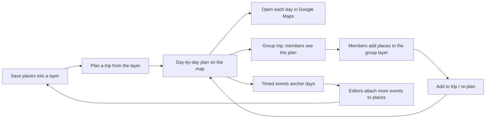
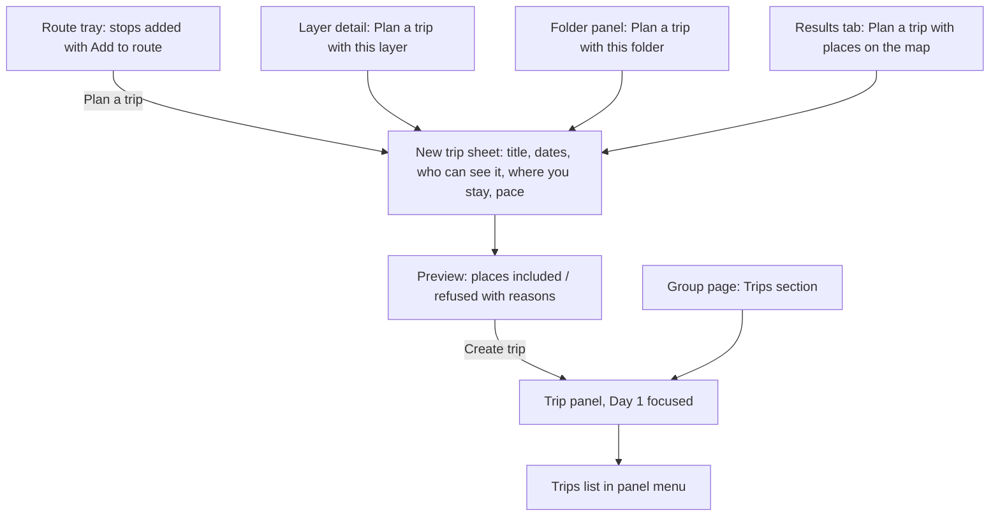

# Trip Scheduler: plan multi-day trips from places in your layers

Status: first slice built locally 2026-11-03 behind `FEATURE_TRIPS` (migration 0037, not on production). Built: the planner (`packages/shared/src/trip-plan.ts`: clustering, nearest-neighbor + 2-opt, pins, manual days, overflow, no-location), `trip`/`trip_day`/`trip_stop`, the service and API (create from a layer, folder or item ids; preview; remove/restore/move stops; manual order; re-order day / re-plan all; remove unavailable; delete), and standalone `/trips`, `/trips/new` and `/trips/[id]` pages with **Plan a trip** on layer detail and the folder panel. Trip base and per-day start/end (5.5) built locally 2026-11-04 (migration 0038, not on production): `trip.base_item_id`, `trip_day.start_kind/start_item_id/end_kind/end_item_id`, `PATCH /trips/{id}` for the base and day patches for overrides, the planner orders each day around its start and end (`tripOptimizerVersion` 2), and the trip page shows the house-badge endpoints, legs and totals. Limits of that slice: clustering into days ignores per-day bases (only the order within a day uses them), the base picker offers places from the trip's own layers that are not already stops, and `POST /trips` accepts `baseItemId` but the create form has no field for it. Not built yet: event anchoring (section 7), adding stops to an existing trip, `PUT /plan` undo of a re-plan, the in-workspace trip panel and route-tray / results entry points, the group page Trips section, and out-of-order detection. Open questions (section 16) were answered with the proposed defaults. Prototype: [docs/design/trip-scheduler/prototype.html](../design/trip-scheduler/prototype.html).

Working name: **Trip** / **行程**. Copy uses `{brand}` where the product name appears.

## Owner decisions (fixed, not re-opened)

| #   | Decision                                                                                                                                                                                                                                                                                      |
| --- | --------------------------------------------------------------------------------------------------------------------------------------------------------------------------------------------------------------------------------------------------------------------------------------------- |
| T1  | **Multi-day.** The date range splits into daily routes. The scheduler assigns places to days and orders a route for each day, with a start and end point per day.                                                                                                                             |
| T2  | **In-house heuristic on the server.** Straight-line (haversine) distance only: clustering into days, then nearest-neighbor plus 2-opt per day. No paid routing API (no Google Routes, no Mapbox Optimization). Distances are estimates, labeled as such, and never shown as real travel time. |

## 1. Problem, users and loop

People already collect places in layers ("Tokyo food", "Saturday club outing", "Taipei with parents"). When they actually go, the layer gives them no plan. They have a pile of pins and a date range, and they work out by hand which places go on which day and in what order. The existing route planner ([map-route-links-plan.md](map-route-links-plan.md)) orders up to 10 stops for one outing, but it lives in memory, can't be saved or shared, and has no idea of days.

**Trip Scheduler:** pick places from your layers, choose dates, and LocalLink proposes a plan. Each day gets a group of nearby places in a short visiting order, drawn on the map as numbered stops. You can remove a place, move it to another day, or reorder a day yourself. Each day opens in Google Maps for real directions, using the existing link builder.

**Target users**

- **Visitors to a launch city** (Taipei, Tokyo, Houston) who built a layer before the trip. For example, a Houston member visiting Taipei for five days with 30 saved places.
- **Group organizers** planning an outing or a group trip from a group layer. The plan is shared with the group and editors can adjust it.
- **Locals hosting visitors** who turn their "show friends around" layer into a weekend plan.

**The loop it joins**



The trip is a **use** surface for the existing collect loop (paste links → layer → group). It gives every saved place a reason to exist: it might end up on a day. It also gives group layers a concrete deadline ("we leave Friday"), which pulls a second contributor into the layer. That is activation stage 5 in [activation-funnel.md](../reference/activation-funnel.md).

## 2. Principles

1. **A trip references, never copies.** Stops point at existing layer items. Names, notes, link names, markers and events still come from the layer item. Coordinates are read at compute time and never stored on the trip (Google's 30-day cache limit, see the [location cache](layer-mvp-google-links-plan.md#location-cache-2026-10-21)).
2. **Access is checked per viewer, every read.** A trip never widens who can see a place. A stop whose source the viewer can't see is omitted from the list, the map, the route line and the distances.
3. **The server only reshuffles what you asked it to.** Removing or moving a stop re-orders only the affected day (or days). Moving stops between days only happens when you press **Re-plan all days**, and that can be undone.
4. **Honest estimates.** Lines are straight segments labeled "order, not roads". Distances say "straight-line, about". The trip shows no travel times. Real directions come from Google Maps through a link.
5. **Deterministic.** The same stops, days, settings and pins give the same plan for a given optimizer version.
6. **Expand through data.** Day limits, distance units, palettes and time zones come from config and the city record, not per-city code.

## 3. What exists today versus what is proposed

| Capability                   | Today                                                                                                                                    | Proposed                                                                                         |
| ---------------------------- | ---------------------------------------------------------------------------------------------------------------------------------------- | ------------------------------------------------------------------------------------------------ |
| Picking stops on the map     | Built: **Add to route** / **Remove from route** on hover cards and place details; **Route through these places** (max 10); no route mode | Reused as the selection tray; adds **Plan a trip**                                               |
| Ordering                     | Built: `shortOrder()` in `apps/web/src/lib/route-link.ts` (nearest-neighbor from every start, client-side, equirectangular distance)     | New shared optimizer (`packages/shared/src/trip-plan.ts`): clustering, NN + 2-opt, run on server |
| Google Maps directions links | Built: `routeLinks()` splits into parts of at most 5 stops; walk / drive / transit                                                       | Reused per day                                                                                   |
| Route drawing                | Built: `route` GeoJSON source in `map-canvas.tsx`: a dashed line plus numbered badges, one color                                         | Extended: per-day color, one day highlighted at a time, "All days" overview                      |
| Saving a route               | None (memory only)                                                                                                                       | `trip`, `trip_day`, `trip_stop` tables                                                           |
| Events on places             | Built: `layer_item_event` (single occurrence, instants, ≤31 days, visible like the layer)                                                | Read to anchor stops to days                                                                     |
| Layer access                 | Built: `accessFor()` in `features/layers/repository.ts`; inaccessible layers look missing                                                | Reused for every stop on every read                                                              |
| Folders                      | Built: `layer_collection` (3 levels)                                                                                                     | Entry point: **Plan a trip** from a folder                                                       |
| Cached Google coordinates    | Built: `place_provider_reference.latitude/longitude/location_fetched_at`, 30-day expiry, cache-only on browse                            | Read at compute time; planning may refresh missing ones (open question Q3)                       |
| Group sharing                | Built: group-owned layers and folders, roles owner / editor / viewer                                                                     | Group-owned trips with the same roles                                                            |

## 4. Data model proposal

Three tables, following the layer and folder patterns: ownership by user **or** group, a `revision` for concurrency, and soft deletion.

```text
trip
  id                uuid pk
  title             text not null (1–120)
  city_id           uuid → city            -- time zone for day boundaries, distance unit, default camera
  owner_user_id     uuid → user  (cascade) -- exactly one owner
  owner_group_id    uuid → group (cascade)
  audience          'private' | 'group'    -- check: private ⇔ owner_user_id, group ⇔ owner_group_id
  starts_on         date not null
  ends_on           date not null          -- check starts_on <= ends_on, span <= maxTripDays
  stops_per_day     smallint default 6     -- check 2..12
  base_item_id      uuid → layer_item (set null)  -- optional "where you stay"; default start/end for each day
  optimizer_version smallint not null      -- version of the heuristic that produced the stored plan
  revision          integer default 1
  status            'active' | 'deleted'   -- soft delete
  deleted_at        timestamptz
  created_by, updated_by → user (set null), created_at, updated_at
  index (owner_user_id) where status='active', index (owner_group_id) where status='active'

trip_day
  id                uuid pk
  trip_id           uuid → trip (cascade)
  on_date           date not null          -- unique (trip_id, on_date); calendar date in the city zone
  order_mode        'auto' | 'manual' default 'auto'
  start_kind        'base' | 'first_stop' | 'item' default 'base'
  start_item_id     uuid → layer_item (set null)   -- used when start_kind='item'
  end_kind          'base' | 'last_stop' | 'item' default 'base'
  end_item_id       uuid → layer_item (set null)
  created_at, updated_at

trip_stop
  id                uuid pk
  trip_id           uuid → trip (cascade)
  layer_item_id     uuid → layer_item (set null)   -- null = source removed
  day_id            uuid → trip_day (set null)     -- null = not scheduled
  position          integer                        -- order within day (or within the unscheduled list)
  pinned            boolean default false          -- user placed it on this day; re-plan keeps it there
  unscheduled_reason 'overflow' | 'no_location' | 'day_removed' | 'user' | null
  status            'active' | 'removed'           -- removed = soft, supports Undo and "Removed from trip"
  added_by          uuid → user (set null), created_at, updated_at
  unique (trip_id, layer_item_id) where status='active' and layer_item_id is not null
  index (trip_id, day_id, position)
```

**What is deliberately not stored:** coordinates, distances, polylines, place names or any snapshot of layer content. All of these are derived per request from the layer item the viewer can see. This keeps the trip within Google's cache terms, avoids stale copies, and means deleting a place in a layer really deletes it everywhere.

### Ownership and access

`tripAccessFor(trip, actor, memberships)` mirrors `accessFor()`:

| Trip owner | View             | Edit stops / days / settings | Delete                             |
| ---------- | ---------------- | ---------------------------- | ---------------------------------- |
| User       | Owner only       | Owner                        | Owner                              |
| Group      | Any group member | Group owner and editor       | Group owner, or the trip's creator |

A trip the actor can't view returns the same neutral 404 as a missing one. Public trips and share links are future work (section 11).

### Which stops a trip may hold (write-time rule)

A stop is added only by layer item ID, and only if:

1. The actor can view the item's layer (`accessFor().view`), and the item holds a place (catalog, Google subject or custom place). Event-only and content-only items are rejected.
2. **The audience fits.** For a private trip, any layer the owner can view is allowed. For a group trip, the layer must be owned by the **same group**, or be a publicly visible (approved, active, public) layer. A place from the actor's private layer, or from another group's layer, is refused with reason `audience_mismatch`. It is never copied into the trip. The creation preview shows refused places with that reason, so nothing is dropped silently.
3. Duplicates collapse. The same place reached through two layer items is kept once, preferring the item from a layer that has events for the trip dates, then the item in the earliest applied layer.

### Read-time rule (per viewer)

A stop is visible to a viewer only if its `layer_item_id` is non-null, the viewer can view that layer **now**, and the place itself is visible: approved catalog place, active custom place, or active subject, using the same predicates as `features/layers/events.ts` `visiblePlace`. Invisible stops are:

- removed from the list, the map, route segments, numbering and distance totals. Neighbors connect directly, and numbering runs over visible stops only;
- counted in a neutral notice shown only to editors: "1 place in this trip is no longer available." It gives no name, layer or location. The notice offers **Remove unavailable places**, which the server applies only to stops that fail the visibility rule for that actor.

### Lifecycle of the source

| Event                                                                             | Effect on the trip                                                                                                                                                                                                    |
| --------------------------------------------------------------------------------- | --------------------------------------------------------------------------------------------------------------------------------------------------------------------------------------------------------------------- |
| Layer item removed (hard delete) or layer deleted (cascade)                       | `trip_stop.layer_item_id` becomes null. The stop drops out of the route and is counted in the "no longer available" notice. No name was stored, so nothing lingers.                                                   |
| Custom place soft-deleted / hidden, subject deactivated, catalog place unapproved | Fails the read-time rule. Same as above, but reversible if the place returns.                                                                                                                                         |
| Layer item edited (note, link name, marker)                                       | Trip shows the new values. Nothing to sync.                                                                                                                                                                           |
| Place moved (custom pin edited, Google cache refreshed)                           | Distances and lines use the new point on the next read. The stored order is not re-optimized automatically. A day whose straight-line length grew by more than 25% shows **This day may be out of order — Re-order**. |
| Google coordinates expired or never fetched                                       | The stop stays in its day in the list, marked "No map location". It is skipped in the line and distances, and keeps a direct **Open in Google Maps** search link.                                                     |
| Viewer loses access (left the group, layer made private)                          | Group trip: losing group membership removes trip access entirely. Private trip that used a group layer: those stops become unavailable for the owner.                                                                 |
| Base or start/end item becomes unavailable                                        | The day falls back to `first_stop` / `last_stop` for that viewer, and the editor sees a notice.                                                                                                                       |
| Trip deleted                                                                      | `status='deleted'`, `deleted_at=now()`. Hidden from all reads. A purge job after 30 days is optional (Q6).                                                                                                            |
| Group or user deleted                                                             | Cascade, same as layers.                                                                                                                                                                                              |

### Concurrency

Every mutation sends `expectedRevision`. The service locks the trip row (`SELECT … FOR UPDATE`), compares revisions, applies the change and its re-optimization in one transaction, then bumps `revision`. A stale revision returns `409 REVISION_CONFLICT`, as layers and reviews already do. The client then reloads and shows "This trip changed on another device. Showing the latest version."

## 5. The heuristic

Pure, framework-independent code in `packages/shared/src/trip-plan.ts`, run only on the server and unit-tested with fixtures. Input: the visible, located stops with coordinates, the days with their start/end points, pins, manual-order days, event anchors and `stops_per_day`. Output: a day assignment, an order per day and an unscheduled list with reasons.

### 5.1 Distance

Haversine distance in meters between WGS84 points. Leg, day and trip totals are rounded for display: 0.1 km / 0.1 mi below 10, whole numbers above. The unit comes from city config (`distanceUnit: "km" | "mi"`, Houston `mi`, Taipei and Tokyo `km`). Only straight-line distance is shown, never a time (Q2).

### 5.2 Inputs, partitioned

1. **Unavailable** stops (fail the read-time rule for the acting editor) are left exactly where they are and ignored.
2. **No location** stops are never optimized. If unpinned they go to unscheduled with reason `no_location`. If the user pinned one to a day, it stays on that day in list position order and is skipped in the line.
3. **Fixed** stops are `pinned` stops, plus every stop on a `manual` day. They keep their day.
4. **Event-anchored** stops: see section 7. They are fixed to their event's day unless the user overrode it.
5. Everything else is **free**.

### 5.3 Day assignment (capacitated clustering)

- Capacity per auto day is `stops_per_day − fixed stops on that day` (minimum 0). Manual days take no free stops.
- Number of clusters k = the number of auto days with capacity. If there are fewer free stops than days, k equals the number of free stops, and the remaining days stay empty with "Free day" copy rather than one stop smeared across many days.
- **Seeding (deterministic):** if the auto days already hold fixed stops, each such day is seeded at the centroid of its fixed stops. The remaining seeds use farthest-point seeding: the first seed is the free stop farthest from the centroid of all free stops, each next seed is the free stop farthest from all existing seeds. Ties break on stop ID (lexicographic).
- **Assignment:** stops are processed in order of regret (distance to second-nearest seed minus distance to nearest), highest first, ties by ID. Each stop goes to the nearest seed with capacity left. Then centroids are recomputed and the pass repeats, at most 10 times or until no stop changes cluster.
- **Cluster → day:** if all days share the same start/end (the base, or none), clusters are matched to days in seed order, with event-seeded clusters already on their day. If days have different bases (for example a hotel change), clusters go to days by greedy minimum centroid-to-base distance, ties by date.
- **Overflow:** if free stops exceed total capacity, the stops left unassigned after the last pass become unscheduled with reason `overflow`. These are the outliers, the stops farthest from every centroid. They are never dropped.

### 5.4 Per-day order

For an auto day with start S (base, item or none) and end E (base, item or none):

1. **Nearest-neighbor.** With a start point, begin at S. Without one, run NN from every stop as the first stop and keep the shortest (as `shortOrder()` does today; at most 12 stops, so this is cheap).
2. **2-opt.** Reverse segments while doing so shortens S → stops → E, accepting only improvements larger than 1 m to avoid float churn. Stop when no move improves, or after 100 passes.
3. **Event order constraint.** Timed event stops on the same day must stay in chronological order of event start. A 2-opt move that breaks that order is rejected. This is an order rule, not a feasibility check: the plan does not know whether you can arrive in time, and the UI says so.
4. Ties break on stop ID throughout.

A manual day is never re-ordered by the optimizer. Removing a stop from it just closes the gap.

### 5.5 Start and end points

| Setting                              | Behavior                                                                                                                       |
| ------------------------------------ | ------------------------------------------------------------------------------------------------------------------------------ |
| Trip base set, day uses `base`       | Round trip: base → stops → base. The base is shown as a house badge, not numbered, and isn't counted against `stops_per_day`.  |
| No base / `first_stop` / `last_stop` | Open path. The optimizer picks the best first stop; the day ends at its last stop.                                             |
| `item` (per-day override)            | A specific layer item, for example the airport on the last day or a second hotel. Must pass the same write-time audience rule. |

The base or override must be a layer item with a map location. It's chosen with the same place picker used for stops, so it inherits privacy rules and needs no new coordinate storage.

### 5.6 Limits (config in `packages/shared`)

| Constant         | Value                             | Why                                                                              |
| ---------------- | --------------------------------- | -------------------------------------------------------------------------------- |
| `maxTripDays`    | 14                                | Bounded UI (day chips) and compute; long trips are rare in a city-scoped product |
| `maxTripStops`   | 80                                | Two layers' worth; clustering stays well under 10 ms                             |
| `stopsPerDay`    | 2–12, default 6                   | A "pace" control rather than a hard truth                                        |
| `maxActiveTrips` | 50 per owner                      | Abuse bound                                                                      |
| Optimize rate    | Existing 30 writes/min per member | Reused                                                                           |

### 5.7 Recompute behavior (recommendation)

**Removing a stop re-orders only that day.** If the day is manual, it only closes the gap. Other days don't change.

Why not rebalance all days:

- **Predictability and trust.** People tell friends "Day 1 is Daan and Zhongshan". A removal on Day 3 must not move Day 1.
- **Stability under group editing.** Two editors removing stops concurrently would otherwise cause cascading reshuffles and more 409s.
- **Cost of a worse balance is small.** At worst one day ends up with one fewer stop. The trip header then shows **Re-plan all days** as an explicit action.

The same rule applies elsewhere:

- Moving a stop to another day re-orders the source and target days, if they're auto. The stop becomes `pinned`.
- Adding a stop uses cheapest insertion into the best auto day with capacity, then re-orders that day. If no day has capacity, the stop goes to unscheduled (`overflow`) with a prompt.
- **Re-plan all days** runs 5.3 and 5.4. It keeps pinned stops on their days, leaves manual days untouched, and returns the previous plan so the client can offer **Undo** (section 6).

### 5.8 Determinism

The optimizer has no randomness and no wall-clock input. Stops are sorted by ID before every pass, tie-breaks use stop ID or date, iteration counts are fixed and comparisons use a 1 m epsilon. `optimizer_version` is stored with the trip. A future heuristic change bumps it, and old trips keep their stored order until someone presses Re-order or Re-plan. A unit test runs every fixture twice, with the input shuffled, and asserts identical output.

### 5.9 Known limits (stated in the UI and docs)

Straight lines ignore roads, rivers, rail lines, one-way streets, transit, traffic, opening hours, ticket times and how long you stay at each place. Clustering can split a walkable street across two days when it sits between clusters. Day order doesn't follow geography when every day shares the same base. Event ordering doesn't check whether there's enough time between events. These limits are why each day hands off to Google Maps for directions.

## 6. Manual control versus auto-optimize

| Action                                 | Who     | Result                                                                                                                                                                                     |
| -------------------------------------- | ------- | ------------------------------------------------------------------------------------------------------------------------------------------------------------------------------------------ |
| Remove from trip                       | Editors | `status='removed'`; that day is re-ordered if auto. A toast offers **Undo** (restores day, position and pin). Removed stops are listed under **Removed from this trip** with **Add back**. |
| Move to another day / to Not scheduled | Editors | Sets `day_id` and `pinned=true` (or `unscheduled_reason='user'`). Both days are re-ordered if auto.                                                                                        |
| Reorder within a day (up/down, drag)   | Editors | Day becomes `order_mode='manual'` and shows the chip **Your order**, with **Let {brand} order this day** to revert to auto (which re-orders it).                                           |
| Pin / unpin to day                     | Editors | Toggles `pinned`. Unpinned stops may move on Re-plan all.                                                                                                                                  |
| Re-order this day                      | Editors | Runs 5.4 on that day. If the day was manual, it becomes auto after a confirm step.                                                                                                         |
| Re-plan all days                       | Editors | Runs 5.3 and 5.4 as above. The response includes `previousPlan`. **Undo** sends it back through `PUT /trips/{id}/plan`.                                                                    |
| Change dates                           | Editors | Added days start empty, with the prompt "Re-plan to use the new days". Removed days send their stops to Not scheduled (`day_removed`, unpinned). Nothing is redistributed automatically.   |
| Change stops per day                   | Editors | Saved; prompts Re-plan. Doesn't auto-run.                                                                                                                                                  |
| Set where you stay / day start or end  | Editors | Re-orders the affected auto days only.                                                                                                                                                     |

`PUT /api/v1/trips/{id}/plan` accepts a complete `{days:[{dayId, stopIds}], unscheduled:[stopIds]}`. The server validates that every active stop appears exactly once and every ID belongs to this trip. It's used for Undo and bulk drag edits. Stop IDs the actor can't see must be passed through unchanged. If not, the server keeps them in place.

## 7. Events and day boundaries

- **Day boundary:** a trip day is a calendar date in the **trip city's IANA time zone** (`city.timezone`). Use the existing `localDate()`, `zonedMidnight()` and `addDays()` from `packages/shared/src/time.ts`.
- **Which events count:** active `layer_item_event` rows on the stop's layer item that the viewer can see (same visibility as the layer) and whose interval overlaps the trip range.
- **Anchoring:**
  - An event that starts and ends on one trip date anchors the stop to that day. The stop is fixed for clustering, and it's labeled "Day 2 · for {event} at 7:00 PM".
  - An event that crosses midnight anchors to its **start** date.
  - Multi-day events (up to 31 days) make the stop eligible only on those days. This is a soft rule: clustering prefers eligible days, and if it can't comply, it places the stop anyway and shows a warning.
  - If a stop has several single-day events in the range, it anchors to the earliest. The stop menu offers "Use {event} on {date} instead".
  - Events outside the range don't anchor. The stop shows "{event} is on Mar 12, outside this trip."
- **User override:** moving an anchored stop to another day pins it and shows "This day misses {event}." The override wins over the event.
- **Event edited or deleted after planning:** the stored day is not changed silently. The stop shows "{event} moved to Mar 6 (Day 3)" with **Move to Day 3**, or the anchor label just disappears when the event is deleted.
- **Times shown** use the trip city's zone through the existing event-time formatting. If the viewer's selected city differs, the city name is appended ("7:00 PM Taipei time").
- The plan never claims that a visit fits around an event. It only puts timed stops in order.

## 8. Map rendering and list fallback

### Map

- **Trip mode:** opening a trip overlays its stops on the map. Applied layer pins stay visible but muted (lower opacity) so the trip reads first. Closing the trip restores them. Marker clicks keep the owner's rule: they always open the place. A trip stop's details add a trip section ("Day 2 · Stop 3", Move to day, Remove from trip).
- **Day focus (default):** one day is highlighted at a time, using the day chips **Day 1 · Mon 3/3**, **Day 2**, and so on. That day shows numbered badges (1…n) and dashed straight segments in its day color, plus the base house badge. Other days show small dots in their color without numbers or lines.
- **All days overview:** every day's line in its color, with a "D1" / "D2" label on each day's first segment, and badges showing day and stop ("2·3") from zoom 13. The list carries the full detail.
- **Approximate line:** the dash pattern from the current route layer is kept. A persistent legend reads **Straight lines show visiting order, not roads**. Hovering or focusing a segment shows "about 1.2 km straight-line".
- **Colors:** a 7-step day palette defined in `map-appearance.ts` (proposed): `#006A51`, `#3B4FC4`, `#A3480F`, `#7A3E9D`, `#805600`, `#0E6E8C`, `#14261F`. Days 8–14 reuse it with a different dash pattern (dotted). Color is never the only cue: day labels, the chip text and the list carry the day. White numerals on each fill target 4.5:1, and lines target 3:1 against the land color. Verify both in the real UI.
- **Camera:** fits the focused day's stops (or the whole trip in All days), using the existing `mapPadding()` rule.
- Unlocated stops get no pin, never a fabricated one.

### List (always available, identical content)

The trip panel lists the same days, stops, order and estimates the map shows. The day chip filter applies to both, so map and list always agree. With no Mapbox token, a failed renderer or the list view, the trip is fully usable as a list:

- Each day: date heading, start ("From: Hotel Sample"), numbered stops with straight-line legs ("about 0.8 km"), end, day total, plus **Open Day 2 in Google Maps** (reusing `routeLinks()` with the travel mode control, split into parts when needed).
- Not scheduled, Removed from this trip, and the unavailable notice follow the days.
- Banner: the existing map-unavailable copy plus "Your trip still works as a list."

## 9. Entry points and where trips live



1. **Route tray (existing):** the tray "Route · 5 stops" gains **Plan a trip**. This is the multi-select path. It keeps the owner's rule that there's no selection mode and marker clicks always open the place. Route keys (`place:` / `subject:` / `custom:`) are resolved on the server to layer items in the applied layers the actor can view.
2. **Layer detail** and **folder panel** actions: **Plan a trip** uses all place items in the layer (or the folder subtree, up to 80; the preview says when more were left out).
3. **Results tab:** **Plan a trip with places on the map**, next to **Route through these places**.
4. **Where trips live:** a **Trips** view in the map panel (`tripPanel=list|detail|new`, `trip=<id>`), reachable from the panel menu next to Layers. A group's trips are also listed on the group page. `/trips/[id]` redirects into the workspace like `/layers/[slug]`. Refresh and Back restore the panel, as layer panels do.
5. **Signed-out visitors** see **Plan a trip** on shared layer views and the route tray. It opens the sign-in prompt with "Sign in to plan and save trips" and returns to the same context afterwards. The in-memory route stays fully available signed out.

## 10. User flows and states

### F1. Plan from a layer (happy path)

1. A member opens layer "Taipei eats" (24 places), then **Plan a trip**.
2. The New trip sheet opens with title "Taipei eats trip", the city from the layer and dates defaulting to the next Friday–Sunday in the city zone. Who can see it: **Just me** (default) or a group where the member is an editor. Optional **Where you stay**. Pace: 6 per day.
3. **Preview:** "22 places will be planned. 2 have no map location yet and will be listed under Not scheduled." For a group trip it also shows "3 places come from your private layer and won't be added."
4. **Create trip** → `POST /api/v1/trips` creates the trip and plans it in one transaction → the trip panel opens with Day 1 focused and the camera fitted.
5. The member removes stop 4 on Day 2. Day 2 re-orders, the line redraws, and a toast reads "Removed. Day 2 re-ordered. Undo".
6. The member opens **Open Day 1 in Google Maps** on their phone.

### F2. Group trip edited by two people

1. An editor creates a group trip from the group layer. All members see it under the group's trips.
2. A second editor adds a newly saved place via **Add to trip** in the place details (a trip picker). It's inserted into the best day.
3. If both edit at once, the later save gets a 409. The client reloads and shows the latest version, and the second editor repeats the edit.

### F3. Too many places

36 places over 3 days at 6 per day gives 18 scheduled and 18 not scheduled (`overflow`). The banner reads "18 places didn't fit in 3 days at 6 per day." with actions **Add a day**, **Allow more per day** and **Choose places**. Nothing is hidden.

### States

| State                              | Behavior                                                                                                                                                                    |
| ---------------------------------- | --------------------------------------------------------------------------------------------------------------------------------------------------------------------------- |
| Signed out                         | Entry points open the sign-in prompt; no trip API is called. `/trips/[id]` gives the neutral sign-in or not-found page.                                                     |
| No trips yet                       | Trips view: "Plan a trip from places in your layers." Buttons: **Choose a layer**, and if the route tray has stops, **Use my route stops**.                                 |
| Single place                       | Valid trip. One day holds one stop and the other days are free. No line. "Add another place to see a route." No Google directions link (as today).                          |
| All places removed                 | The trip stays, with empty days: "This trip has no places. Add places from your layers." Removed places can be added back. The trip isn't auto-deleted.                     |
| Every place without a map location | The plan becomes a list only, with every stop under Not scheduled (`no_location`). "None of these places have a map location yet. You can still put them on days yourself." |
| One-day trip                       | Same model with one day (this is the saved version of today's route).                                                                                                       |
| Plan error (server)                | The previous plan stays visible. Error banner "Couldn't update the plan. Your trip wasn't changed." with **Try again**. The mutation transaction rolled back.               |
| Revision conflict                  | Reload, then "This trip changed on another device. Showing the latest version."                                                                                             |
| Trip unavailable or deleted        | Neutral "This trip isn't available." (404), with no hint whether it exists.                                                                                                 |
| Places no longer available         | Editors see the neutral count notice and **Remove unavailable places**. Viewers see nothing extra.                                                                          |
| No map token / map failure         | Full list mode (section 8).                                                                                                                                                 |
| Feature flag off                   | Entry points hidden. API returns 404 `DISABLED`, matching `writable()`.                                                                                                     |

## 11. UI spec

### Layout per breakpoint (mobile first)

- **320–599 px:** the trip lives in the existing bottom sheet. Peek height shows the trip title, the date range and a horizontally scrollable day chip row (All · Day 1 · Day 2 …). Half height shows the focused day's stop list. Full height adds Not scheduled, Removed and the settings link. Stop rows are 56 px with ≥44 px tap targets: number badge, name, a leg distance line ("about 0.8 km from previous"), event label if any, and an overflow menu (Move to day, Pin, Remove). Reordering uses up/down buttons in the menu (no drag-only interactions). A sticky footer inside the sheet holds **Open Day N in Google Maps**.
- **600–1099 px:** same sheet pattern, with stop rows showing the actions inline (up, down, remove) like `RoutePlanner`.
- **1100 px and up:** the floating left panel (same width as the layer workspace). Day chips sit under the header, and the stop list scrolls. Hovering a row highlights its badge on the map, and focusing a badge highlights the row.

### Components

| Reuse (no edits implied here)                                                          | For                                                |
| -------------------------------------------------------------------------------------- | -------------------------------------------------- |
| `components/map/route-planner.tsx` (pattern, travel mode segmented control, link list) | Per-day stop list and Google links                 |
| `lib/route-link.ts` `routeLinks()`                                                     | Per-day Google Maps links                          |
| `components/map/map-canvas.tsx` route source/layers                                    | Extended for per-day colors and focus              |
| `components/layers/workspace-screen.tsx`, `workspace-navigation.tsx`                   | Panel screens and back navigation                  |
| `components/layers/folder-panel.tsx`, `layer-actions.tsx`                              | **Plan a trip** actions                            |
| `components/ui/field.tsx`                                                              | Title, dates, pace inputs                          |
| `components/layers/add-to-layer.tsx` (picker pattern)                                  | **Add to trip** picker and "Where you stay" picker |
| `lib/event-time.ts`                                                                    | Event labels in the trip zone                      |

New components (proposed): `components/trips/trip-panel.tsx`, `trip-day-chips.tsx`, `trip-stop-row.tsx`, `trip-create-sheet.tsx`, `trip-list.tsx`, `trip-legend.tsx`.

### Accessibility

- The day chips are a `role="tablist"`, and the stop list is an `<ol>` per day with a visible heading.
- Plan updates are announced in a polite live region ("Day 2 re-ordered, 5 stops, about 6.3 km").
- Every action is reachable by keyboard. Drag-and-drop, if added, is an enhancement over the menu.
- Distance text always includes "straight-line" (in `aria-label` too).
- Reflows at 320 px and 200% zoom.

### Copy keys (`apps/web/src/lib/dictionary.ts`, both locales; Traditional Chinese to be reviewed by a native speaker)

| Key                     | English                                                                                 | Traditional Chinese                                        |
| ----------------------- | --------------------------------------------------------------------------------------- | ---------------------------------------------------------- |
| `tripsTitle`            | Trips                                                                                   | 行程                                                       |
| `tripPlan`              | Plan a trip                                                                             | 規劃行程                                                   |
| `tripPlanFromLayer`     | Plan a trip with this layer                                                             | 用這個圖層規劃行程                                         |
| `tripPlanFromFolder`    | Plan a trip with this folder                                                            | 用這個資料夾規劃行程                                       |
| `tripPlanFromMap`       | Plan a trip with places on the map                                                      | 用地圖上的地點規劃行程                                     |
| `tripUseRouteStops`     | Use my route stops                                                                      | 使用我的路線站點                                           |
| `tripNewTitle`          | New trip                                                                                | 新行程                                                     |
| `tripName`              | Trip name                                                                               | 行程名稱                                                   |
| `tripDates`             | Dates                                                                                   | 日期                                                       |
| `tripDatesHint`         | Up to {max} days. Days follow {city} time.                                              | 最多 {max} 天，日期以{city}時間為準。                      |
| `tripAudience`          | Who can see it                                                                          | 誰可以看到                                                 |
| `tripAudiencePrivate`   | Just me                                                                                 | 只有我                                                     |
| `tripAudienceGroup`     | Members of {group}                                                                      | {group} 的成員                                             |
| `tripBase`              | Where you stay (optional)                                                               | 住宿地點（選填）                                           |
| `tripBaseHint`          | Each day starts and ends here.                                                          | 每天從這裡出發並回到這裡。                                 |
| `tripPace`              | Places per day                                                                          | 每天地點數                                                 |
| `tripPreviewIncluded`   | {count} places will be planned.                                                         | 將規劃 {count} 個地點。                                    |
| `tripPreviewNoLocation` | {count} have no map location yet and will be listed under Not scheduled.                | {count} 個地點尚無地圖位置，會列在「未排入」。             |
| `tripPreviewRefused`    | {count} come from layers this group can't see and won't be added.                       | {count} 個地點來自此群組無法查看的圖層，不會加入。         |
| `tripCreate`            | Create trip                                                                             | 建立行程                                                   |
| `tripDay`               | Day {n}                                                                                 | 第 {n} 天                                                  |
| `tripAllDays`           | All days                                                                                | 全部天數                                                   |
| `tripFreeDay`           | Free day — nothing planned.                                                             | 自由日，尚未安排。                                         |
| `tripFrom`              | From: {name}                                                                            | 出發：{name}                                               |
| `tripBackTo`            | Back to: {name}                                                                         | 回到：{name}                                               |
| `tripLegEstimate`       | about {distance} straight-line                                                          | 直線距離約 {distance}                                      |
| `tripDayEstimate`       | Day total about {distance} straight-line                                                | 本日直線總距離約 {distance}                                |
| `tripLegend`            | Straight lines show visiting order, not roads.                                          | 直線僅表示造訪順序，並非實際道路。                         |
| `tripEstimateNote`      | Distances are straight-line estimates. Use Google Maps for directions and travel times. | 距離為直線估算，路線與交通時間請以 Google 地圖為準。       |
| `tripOpenDay`           | Open Day {n} in Google Maps                                                             | 在 Google 地圖開啟第 {n} 天                                |
| `tripNotScheduled`      | Not scheduled                                                                           | 未排入                                                     |
| `tripOverflow`          | {count} places didn't fit in {days} days at {perDay} per day.                           | {count} 個地點無法在 {days} 天內排入（每天 {perDay} 個）。 |
| `tripAddDay`            | Add a day                                                                               | 增加一天                                                   |
| `tripAllowMore`         | Allow more per day                                                                      | 每天多排一些                                               |
| `tripNoLocation`        | No map location                                                                         | 無地圖位置                                                 |
| `tripRemove`            | Remove from trip                                                                        | 從行程移除                                                 |
| `tripRemoved`           | Removed. Day {n} re-ordered.                                                            | 已移除，第 {n} 天已重新排序。                              |
| `tripUndo`              | Undo                                                                                    | 復原                                                       |
| `tripRemovedList`       | Removed from this trip                                                                  | 已從此行程移除                                             |
| `tripAddBack`           | Add back                                                                                | 加回                                                       |
| `tripMoveToDay`         | Move to another day                                                                     | 移到其他天                                                 |
| `tripPin`               | Keep on this day                                                                        | 固定在這一天                                               |
| `tripPinned`            | Kept on Day {n}                                                                         | 已固定在第 {n} 天                                          |
| `tripYourOrder`         | Your order                                                                              | 自訂順序                                                   |
| `tripAutoOrder`         | Let {brand} order this day                                                              | 讓 {brand} 排序這一天                                      |
| `tripReorderDay`        | Re-order this day                                                                       | 重新排序這一天                                             |
| `tripReplanAll`         | Re-plan all days                                                                        | 重新規劃所有天數                                           |
| `tripReplanDone`        | Re-planned. {moved} places changed days.                                                | 已重新規劃，{moved} 個地點換了日期。                       |
| `tripOutOfOrder`        | This day may be out of order.                                                           | 這一天的順序可能需要調整。                                 |
| `tripEventAnchor`       | For {event} at {time}                                                                   | 配合 {event}（{time}）                                     |
| `tripEventMissed`       | This day misses {event}.                                                                | 這一天會錯過 {event}。                                     |
| `tripEventMoved`        | {event} moved to {date} (Day {n}).                                                      | {event} 已改到 {date}（第 {n} 天）。                       |
| `tripEventOutside`      | {event} is on {date}, outside this trip.                                                | {event} 在 {date}，不在此行程期間。                        |
| `tripEventOrderNote`    | Timed events are put in order; the plan doesn't check travel time between them.         | 有時間的活動會依序排列，但不會檢查之間的交通時間。         |
| `tripUnavailable`       | {count} places in this trip are no longer available.                                    | 此行程有 {count} 個地點已無法查看。                        |
| `tripRemoveUnavailable` | Remove unavailable places                                                               | 移除無法查看的地點                                         |
| `tripSinglePlace`       | Add another place to see a route.                                                       | 再加一個地點即可看到路線。                                 |
| `tripEmpty`             | This trip has no places. Add places from your layers.                                   | 此行程還沒有地點，從你的圖層加入地點吧。                   |
| `tripListEmpty`         | Plan a trip from places in your layers.                                                 | 用圖層中的地點規劃行程。                                   |
| `tripAllNoLocation`     | None of these places have a map location yet. You can still put them on days yourself.  | 這些地點都還沒有地圖位置，你仍可自行安排到各天。           |
| `tripMapFallback`       | Your trip still works as a list.                                                        | 行程仍可用清單檢視。                                       |
| `tripError`             | Couldn't update the plan. Your trip wasn't changed.                                     | 無法更新行程，行程未變更。                                 |
| `tripConflict`          | This trip changed on another device. Showing the latest version.                        | 此行程已在其他裝置變更，已顯示最新版本。                   |
| `tripNotAvailable`      | This trip isn't available.                                                              | 無法查看此行程。                                           |
| `tripSignIn`            | Sign in to plan and save trips.                                                         | 登入即可規劃並儲存行程。                                   |
| `tripAddTo`             | Add to trip                                                                             | 加入行程                                                   |
| `tripDelete`            | Delete trip                                                                             | 刪除行程                                                   |
| `tripDeleteConfirm`     | Delete this trip? Places stay in their layers.                                          | 要刪除此行程嗎？地點仍會保留在圖層中。                     |

Distances are formatted by a helper that takes the city's `distanceUnit` and locale ("1.2 km", "0.8 mi", "1.2 公里", "0.8 英里").

## 12. API sketch (for implementers)

All routes go through the existing `[...path]` router: Zod-validated bodies, actor from the session, and a 404 `DISABLED` when `FEATURE_TRIPS` is off. The service lives in `apps/web/src/features/trips/{service,repository}.ts` and the pure optimizer in `packages/shared/src/trip-plan.ts`.

| Method | Path                                | Contract                                                                                                                                           |
| ------ | ----------------------------------- | -------------------------------------------------------------------------------------------------------------------------------------------------- |
| GET    | `/api/v1/trips?scope=mine\|groups`  | Trip summaries the actor can view: `{id,title,city,startsOn,endsOn,owner:{kind,groupName?},stopCount,updatedAt}`. Counts cover visible stops only. |
| POST   | `/api/v1/trips/preview`             | `{city,groupId?,layerItemIds?                                                                                                                      | layerId?                                      | collectionId?                                                                                                                        | mapKeys?+layers?}`→`{included:[itemId], noLocation:[itemId], refused:[{itemId?,reason}]}`. Nothing is written. |
| POST   | `/api/v1/trips`                     | `{title,city,startsOn,endsOn,groupId?,stopsPerDay?,baseItemId?,layerItemIds}` → creates and plans in one transaction → trip view.                  |
| GET    | `/api/v1/trips/{id}`                | Per-viewer view: `{trip,revision,canEdit,days:[{id,date,orderMode,start?,end?,stops:[{id,itemId,key,label,location                                 | null,legMeters                                | null,pinned,event?}],totalMeters}],notScheduled,removed,unavailableCount}`. Coordinates are transient in the response, never stored. |
| PATCH  | `/api/v1/trips/{id}`                | `{expectedRevision,title?,startsOn?,endsOn?,stopsPerDay?,baseItemId?}`                                                                             |
| DELETE | `/api/v1/trips/{id}`                | Soft delete.                                                                                                                                       |
| POST   | `/api/v1/trips/{id}/stops`          | `{expectedRevision,layerItemIds}` → cheapest insertion (5.7).                                                                                      |
| PATCH  | `/api/v1/trips/{id}/stops/{stopId}` | `{expectedRevision,dayId                                                                                                                           | null?,pinned?,status?:'active'                | 'removed'}`                                                                                                                          |
| PATCH  | `/api/v1/trips/{id}/days/{dayId}`   | `{expectedRevision,orderMode?,order?:[stopId],startKind?,startItemId?,endKind?,endItemId?}`                                                        |
| POST   | `/api/v1/trips/{id}/optimize`       | `{expectedRevision,scope:'day'                                                                                                                     | 'all',dayId?}`→ trip view plus`previousPlan`. |
| PUT    | `/api/v1/trips/{id}/plan`           | `{expectedRevision,days:[{dayId,stopIds}],notScheduled:[stopId]}`, used for Undo and bulk edits.                                                   |

Coordinates are resolved server-side in one query per request: catalog `place.latitude/longitude`; `custom_place` when `location_status <> 'unspecified'`; subjects through `place_provider_reference` when `location_fetched_at` is within 30 days.

**Analytics** (server, transactional, coarse; no places, names, coordinates or trip titles):

- `trip_created {owner: user|group, days, stops, noLocation, refused}`
- `trip_optimized {scope: day|all, stops, days}`
- `trip_stop_removed {owner}`
- `trip_stop_moved {owner}`
- `trip_day_opened {mode, links}` (client `track`, like `route_opened`)

## 13. Connections to the rest of the product

| Feature               | Connection                                                                                                                                                                         | MVP / Future                 |
| --------------------- | ---------------------------------------------------------------------------------------------------------------------------------------------------------------------------------- | ---------------------------- |
| Layers and folders    | Source of every stop. **Plan a trip** on layer and folder actions                                                                                                                  | MVP                          |
| Route planner         | Its tray is the multi-select. **Plan a trip** saves it. Day links reuse `routeLinks()`                                                                                             | MVP                          |
| Layer item events     | Anchor days, so attaching events becomes more valuable                                                                                                                             | MVP                          |
| Groups                | Group-owned trips visible to members, edited by editors                                                                                                                            | MVP                          |
| Map / list fallback   | Identical day-filtered content, full list mode                                                                                                                                     | MVP                          |
| Reviews               | A stop row shows the layer item's rating (`item-ratings`). After a trip day, prompt "How was it?" on that day's stops, which opens the existing review form                        | Rating in MVP; prompt Future |
| Read-only share links | A revocable trip share link (like `layer_share_link`) that shows only stops from layers the link may expose (public layers, or layers shared by link). Needs its own audience rule | Future                       |
| Trip → layer          | "Save this trip as a layer" (references only) to share a curated itinerary, or "Add Not scheduled places to a new layer for next time"                                             | Future                       |
| Daily Pick            | "Add today's pick to Day N" when the trip city matches                                                                                                                             | Future                       |
| Chat capture (LINE)   | "Send to my trip" target: a captured link lands in the trip's source layer and is inserted into a day                                                                              | Future                       |
| MCP connector         | Read-only "list my trip days" tool for assistants, scoped like layers                                                                                                              | Future                       |

## 14. Growth notes

**What scales next, through data rather than screens**

- New cities: the trip uses `city.timezone` and city config `distanceUnit`, with nothing city-specific in code.
- More languages: copy keys only.
- Group types: trips inherit group roles, so any future group kind works unchanged.
- Better routing later: `optimizer_version` lets a better heuristic, or a licensed routing provider if the owner ever changes T2, replace the ordering without a data migration.
- Time-of-day slots (morning / afternoon / evening) can be added as a nullable `trip_stop.slot` column later.

**Metrics that indicate healthy play**

- Share of active layers with at least one trip (layers getting used, not just collected).
- Trips where at least one day was opened in Google Maps (utility).
- Group trips with edits by two or more distinct members within 7 days (the activation stage 5 signal, on trips).
- Places added to a source layer after its trip was created (trip pulls contributions).
- Ratio of Re-plan all to manual edits. A high Undo rate after Re-plan means the heuristic is surprising people.
- Share of stops in `no_location` (data quality on Google cache expiry).

**Risks**

- **Over-trust in estimates:** mitigated by straight-line wording, the legend, no times and the Google hand-off.
- **Privacy leak through group trips:** mitigated by the write-time audience rule plus the per-viewer read filter. Test both.
- **Google cache expiry** makes long-lived trips lose pins. That's honest but annoying; Q3 decides whether planning refreshes locations.
- **Feature sprawl:** route planner and trips overlap. The design keeps one tray and one link builder. Later, the in-memory route could become an unsaved one-day trip (Q7).
- **Group edit contention:** revision conflicts. Mitigated by day-scoped recompute.

## 15. Build slices

| #   | Agent       | Slice                                                                                                                                                                                                                                                                                 | Verification                                                                                                                                                       |
| --- | ----------- | ------------------------------------------------------------------------------------------------------------------------------------------------------------------------------------------------------------------------------------------------------------------------------------- | ------------------------------------------------------------------------------------------------------------------------------------------------------------------ |
| S0  | implementer | `packages/shared/src/trip-plan.ts`: haversine, capacitated clustering, NN + 2-opt with event-order constraint, overflow, determinism, limits constants, Zod inputs. No I/O.                                                                                                           | Unit fixtures: 1 / 2 / 12 / 80 stops, overflow, pins, manual days, bases, per-day bases, events (single, multi-day, midnight), shuffled-input determinism, version |
| S1  | db-migrator | `trip`, `trip_day`, `trip_stop` in `schema.ts` with checks, partial unique and indexes. `pnpm db:generate`, review SQL, apply to local disposable DB. Add `distanceUnit` to city config in `packages/shared/src/cities.ts`.                                                           | Migration applies and rolls forward on local DB; schema snapshot reviewed                                                                                          |
| S2  | implementer | `features/trips`: `tripAccessFor`, repository (per-viewer stop visibility, coordinate resolution, events in range), service (create / preview / add / remove / move / day patch / optimize / plan PUT) with revision locks and audit analytics. Router entries. `FEATURE_TRIPS` flag. | Integration: authz matrix (owner, group roles, non-member 404), audience refusal, per-viewer omission, source deletion → unavailable, 409 conflicts, soft delete   |
| S3  | implementer | Map canvas: per-day route sources and colors, day focus, All days overview, muted layer pins in trip mode, legend.                                                                                                                                                                    | Unit for GeoJSON builders; E2E map shows numbered day stops                                                                                                        |
| S4  | ui-i18n     | Trip panel (list, detail, create sheet, preview, day chips, stop rows, menus, toasts, Not scheduled / Removed / unavailable sections, per-day Google links), entry points (route tray, layer, folder, results), panel URL state, all en/zh keys, list-only fallback.                  | E2E: plan from layer, remove → day re-orders, move day, Undo re-plan, no-token list mode, signed-out prompt, mobile 320 px; a11y keyboard pass                     |
| S5  | implementer | Event anchoring UI (labels, moved / missed / outside notices), "out of order" detection, group page Trips section.                                                                                                                                                                    | Integration on event edit/delete; E2E group trip seen by member, editable by editor only                                                                           |
| S6  | (owner)     | Rollout: migration to prod, flag on. Needs owner authorization.                                                                                                                                                                                                                       | Live smoke                                                                                                                                                         |

S0 and S1 can run in parallel. S2 needs both, S3 and S4 need S2's response shape (S3 can start against fixtures), and S5 follows S4.

## 16. Open questions for the owner

1. **Q1 Trip city and places outside it.** Layers can hold places anywhere (M6). Should a trip's day boundaries always use the chosen city's time zone, or should the trip store its own IANA zone so a Houston member can plan, say, Kyoto? The proposal uses the city for now.
2. **Q2 Travel time.** The design shows straight-line distance only and no time. Is that acceptable, or do you want a clearly labeled "about N min walking at 4 km/h, straight-line" estimate? It's not recommended: it looks like real travel time.
3. **Q3 Refreshing Google locations when planning.** Pressing Create or Re-plan is explicit intent. May it refresh missing or expired Google coordinates for the trip's places (existing server lookup, at most 60 per request, Place Details location only, paid)? Or should unlocated places stay under Not scheduled until a card is loaded by hand, as browsing does?
4. **Q4 Default range behavior.** With fewer places than days, the proposal leaves extra days free rather than spreading one place per day. Agree?
5. **Q5 Group trip deletion.** Group owner or the trip's creator (proposed), or any editor?
6. **Q6 Purge.** Should soft-deleted trips be purged after 30 days, or kept indefinitely like other soft-deleted records?
7. **Q7 Route planner convergence.** Keep the in-memory route as is (proposed for the MVP), or later make it an unsaved one-day trip so there's one model?
8. **Q8 Limits.** Are 14 days, 80 places and 2–12 per day (default 6) the right bounds?
